安全
===============

.. toctree:: 
   :maxdepth: 6

背景
------------------------------------------------
工业机器人作为工业智能制造发展中的关键执行单元，其安全性能已上升为设备全生命周期管理中的核心要素。当前，业内普遍要求安全功能相关参数具备固化的不可篡改性，并建立完整、可追溯的校验机制，以满足严苛的安全合规审计需求。
欧洲地区系统集成商及终端用户在实际项目验收中，进一步对安全配置的透明化与可验证性提出了明确要求。具体而言，安全功能调试完成后，系统应能够自动生成一份包含完整性校验和（Checksum）的安全配置报告，且该校验和须在设备Web管理界面中实时同步呈现。这一机制旨在确保任何对安全参数的修改均可被有效识别与记录，从而为设备的安全状态评估、现场验收及后续运维提供可信赖的依据。
有鉴于此，本设备在安全架构设计上，不仅遵循相关国际安全标准，同时内建了安全配置导出与校验和实时显示功能，以协助操作人员与安全管理人员便捷、可靠地完成配置确认及合规性证明工作。

安全配置校验和
------------------------------------------------

打开web页面，安全校验和位于网页右上角，由8位16进制表示。安全校验和具有唯一性，当安全配置参数发生变更时，安全校验和随之更改。

.. centered:: 图表 7.1-1 安全配置校验和显示

点击安全校验和，即可显示当前安全校验和所代表的安全配置参数集合。

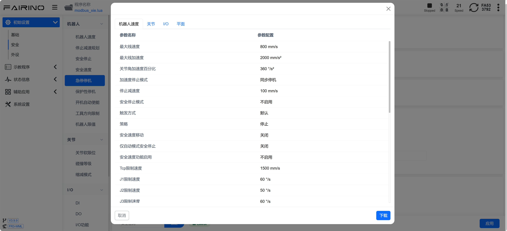

.. centered:: 图表 7.1-2 安全配置参数

安全配置参数支持导出PDF报告，点击下载即可预览PDF报告，同时支持导出。点击保存按钮，即可下载PDF报告。

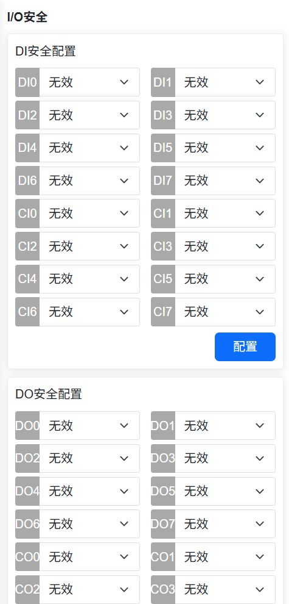

.. centered:: 图表 7.1-3 安全配置报告PDF预览

安全配置参数管理
------------------------------------------------

当前机器人所有相关安全配置参数统一放于web页面“初始设置”-“安全”页面中进行维护。安全配置参数修改需要先输入“安全配置密码”进行校验，校验成功后方可进行安全参数配置修改。

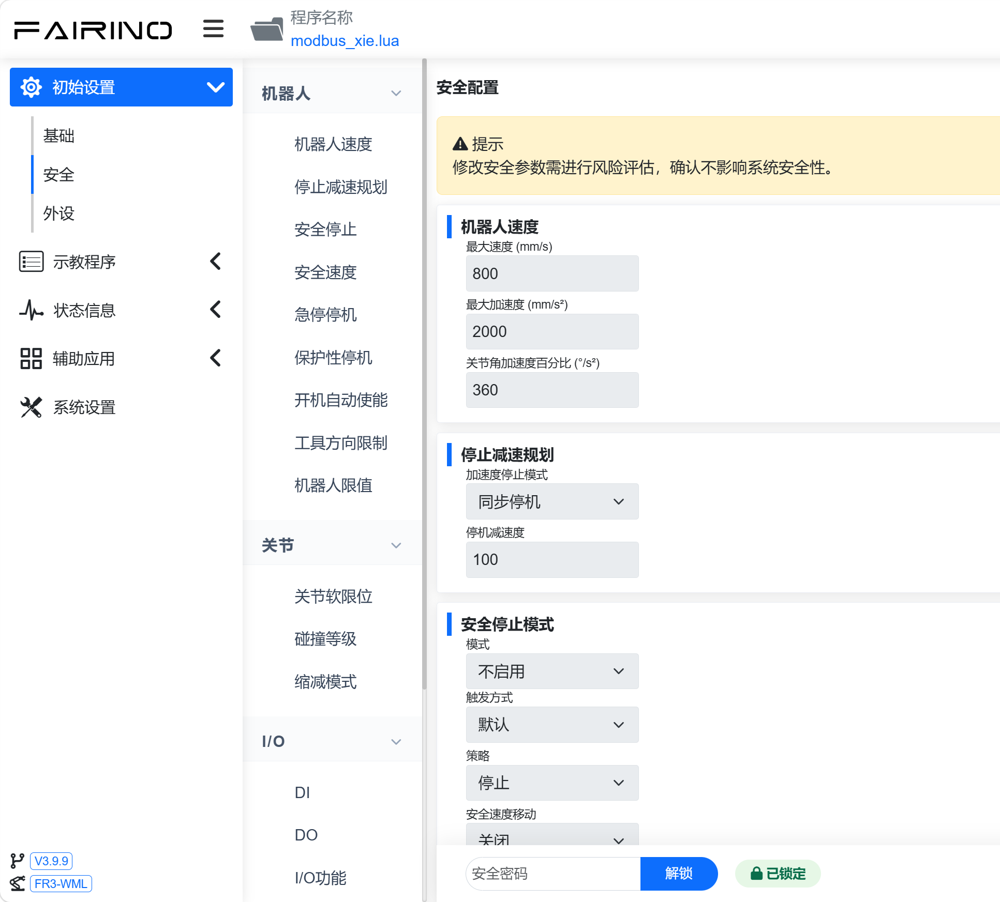

.. centered:: 图表 7.2-1 安全配置密码校验

修改安全配置参数后，点击“应用”，需要二次确认修改的安全配置参数，点击“确认”即可应用参数。参数应用成功后安全配置校验和会随之更新。

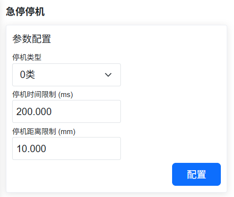

.. centered:: 图表 7.2-2 安全配置参数二次确认

网络安全功能
------------------------------------------------------------------------

安全密码管理
~~~~~~~~~~~~~~~~~~~~~~~~~~~~~~~~~~~~~~~~~~~~~~~~~~~~~~~~~~~~~~~~~~~~~~~~~~~~~~

安全密码修改
+++++++++++++++++++++++++++++++++++++++++++++++++++++++++++++++++++++

安全密码默认为“12345678”；安全密码可在“安全”页面中修改，点击“修改安全密码”按钮，弹出安全密码修改窗口，分别输入旧密码和新密码，即可完成安全密码的修改；

.. centered:: 图表 7.3-1 安全密码修改按钮

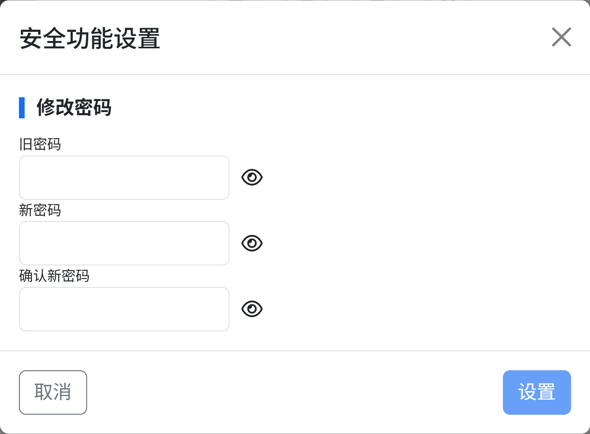

.. centered:: 图表 7.3-2 安全密码修改窗口

新、旧安全密码不可相同，安全密码长度至少8位，且需要包含大小写字母、数字和特殊字符。

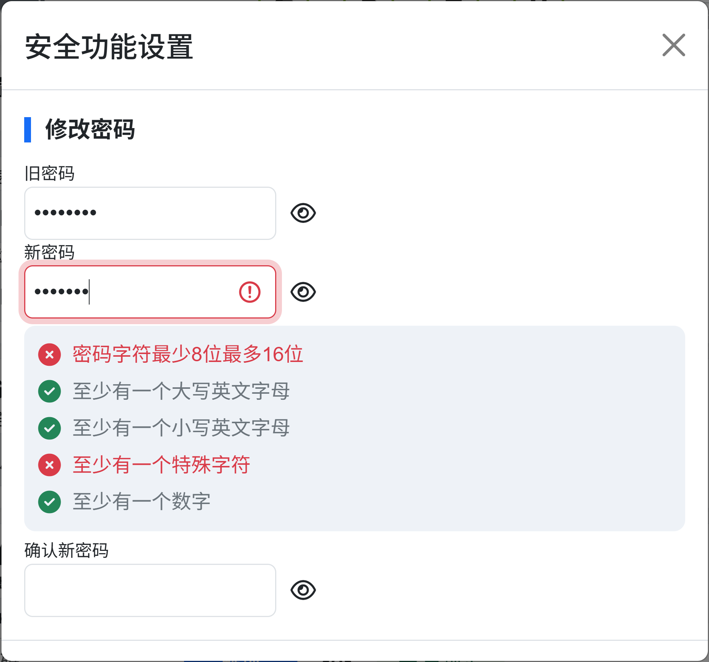

.. centered:: 图表 7.3-3 安全密码复杂度校验

安全密码防护
+++++++++++++++++++++++++++++++++++++++++++++++++++++++++++++++++++++

机器人安全密码输入解锁具有防暴力破解功能，连续5次输入错误密码，且每次的间隔时间均小于1min时，将触发安全密码输入锁定1min，在1min内无法输入密码解锁，同时WebApp中具有倒计时显示。

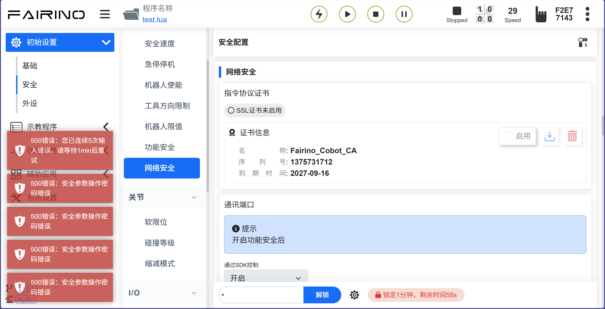

.. centered:: 图表 7.3-4 安全密码防暴力破解锁定

网络安全
~~~~~~~~~~~~~~~~~~~~~~~~~~~~~~~~~~~~~~~~~~~~~~~~~~~~~~~~~~~~~~~~~~~~~~~~

机器人网络安全功能包括指令协议加密通讯、非加密通讯端口默认禁用、软件升级、启动过程中完整性校验等，用于身份鉴别，防窃听篡改，抵御网络攻击，保障通信安全可控。

网络安全环境信息
+++++++++++++++++++++++++++++++++++++++++++++++++++++++++++++++++++++

用户必须满足下述环境要求，才能保障协作机器人网络安全功能有效；若环境不符合要求，协作机器人安全防护能力可能下降，存在安全风险。

物理安全环境
*******************************************************************************

①机器人控制器及需要经过的交换机必须安装在配备锁止装置的控制柜内。严禁非授权人员开启柜门，未经授权，禁止触碰控制器的以太网端口及安全 I/O 端口等任何接口。 

②机器人控制器以太网口仅用于连接工控机，禁止私人计算机直连或通过交换机连接控制器网口。非授权人员禁止接触与机器人具有网络连接的工控机，为工控机设置登录密码。

③机器人示教器、按钮盒均应置于安全工作区域中，非授权人员禁止进入该区域。

机器人安全配置
*******************************************************************************

①为不同权限的人员设置具有相应权限的WebApp登录账号，特别是软固件升级、安全参数配置权限等；

②修改机器人WebApp管理员登录密码、安全配置密码；并妥善保管密码，避免泄露；

③使用指令协议通讯请开启加密，并妥善保管从机器人中下载的任何网络通讯加密证书，严禁证书外泄。

④非加密通讯端口保持默认禁用，非必要不开启。

网络安全功能版本要求
+++++++++++++++++++++++++++++++++++++++++++++++++++++++++++++++++++++

机器人软件版本V4.0.0及以上支持网络安全功能，低于该版本编号的机器人软件不支持网络安全功能。

WebApp通讯加密
+++++++++++++++++++++++++++++++++++++++++++++++++++++++++++++++++++++

机器人WebApp通讯为TLS1.2的https加密通讯。在使用WebApp时需要进行证书安装(若不安装证书，则浏览器会显示不安全的连接)；具体步骤如下：

①在浏览器中输入机器人IP地址，如192.168.58.2，按下回车键，进行机器人WebApp页面访问，此时浏览器将显示连接不安全提示；

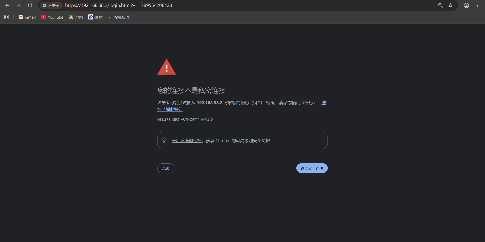

.. centered:: 图表 7.3-5 显示不安全的连接

②在IP地址输入框左侧点击“不安全”，弹出连接详细信息窗口；

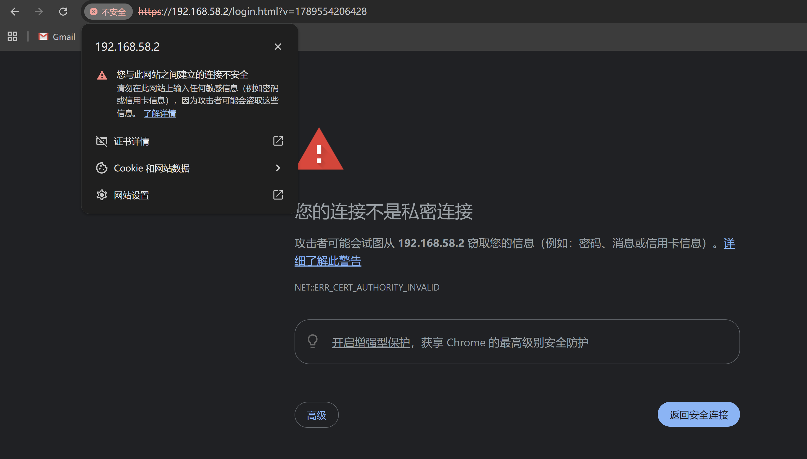

.. centered:: 图表 7.3-6 连接详细信息窗口弹出

③在窗口中点击“证书详情”，弹出证书详细信息窗口，在上部的选项卡中选择“详细信息”，并点击“导出”按钮下载证书；下载的证书名称通常为机器人IP地址，需要重命名该文件，并添加后缀名“.crt”，如“192.168.58.2”改为“192.168.58.2.crt”。

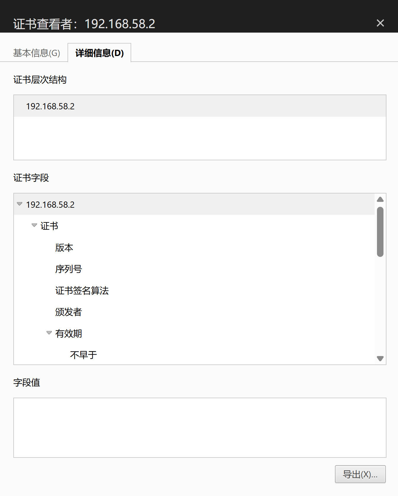

.. centered:: 图表 7.3-7 证书详细信息窗口

.. image:: safety/053.png
   :width: 4in
   :align: center

.. centered:: 图表 7.3-8 证书文件名称

④双击该证书文件，弹出证书安装窗口，点击“安装证书”。

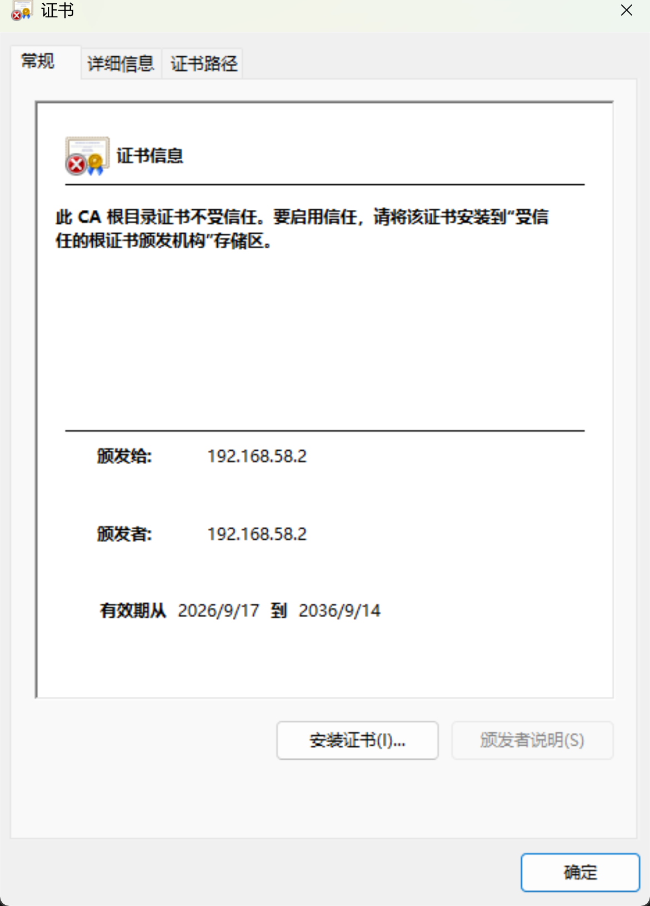

.. centered:: 图表 7.3-9 证书安装窗口

⑤在弹出的证书安装向导中选择存储位置为本地计算机；并点击下一步；

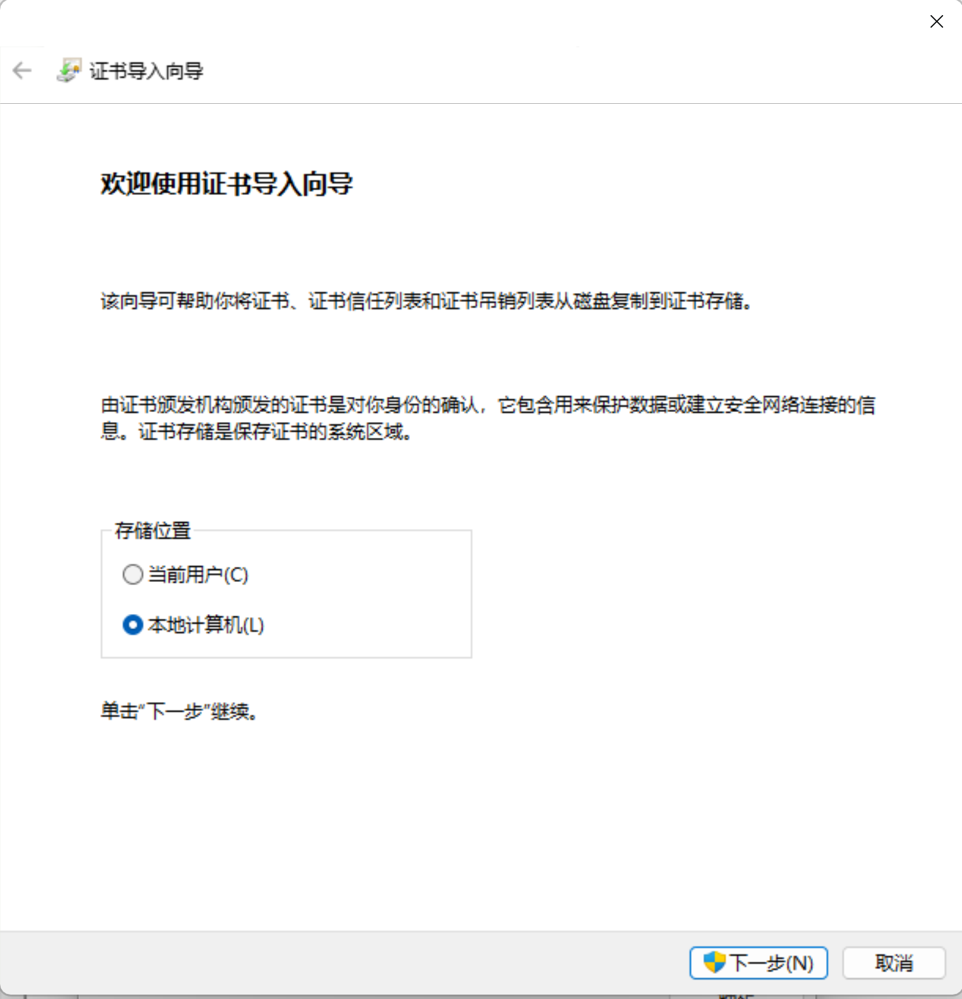

.. centered:: 图表 7.3-10 选择存储位置为本地计算机

⑥在证书向导窗口中选择“将所有的证书都放入下列存储”，点击“浏览”按钮，并选择“受信任的根证书颁发机构”。点击“下一步”；

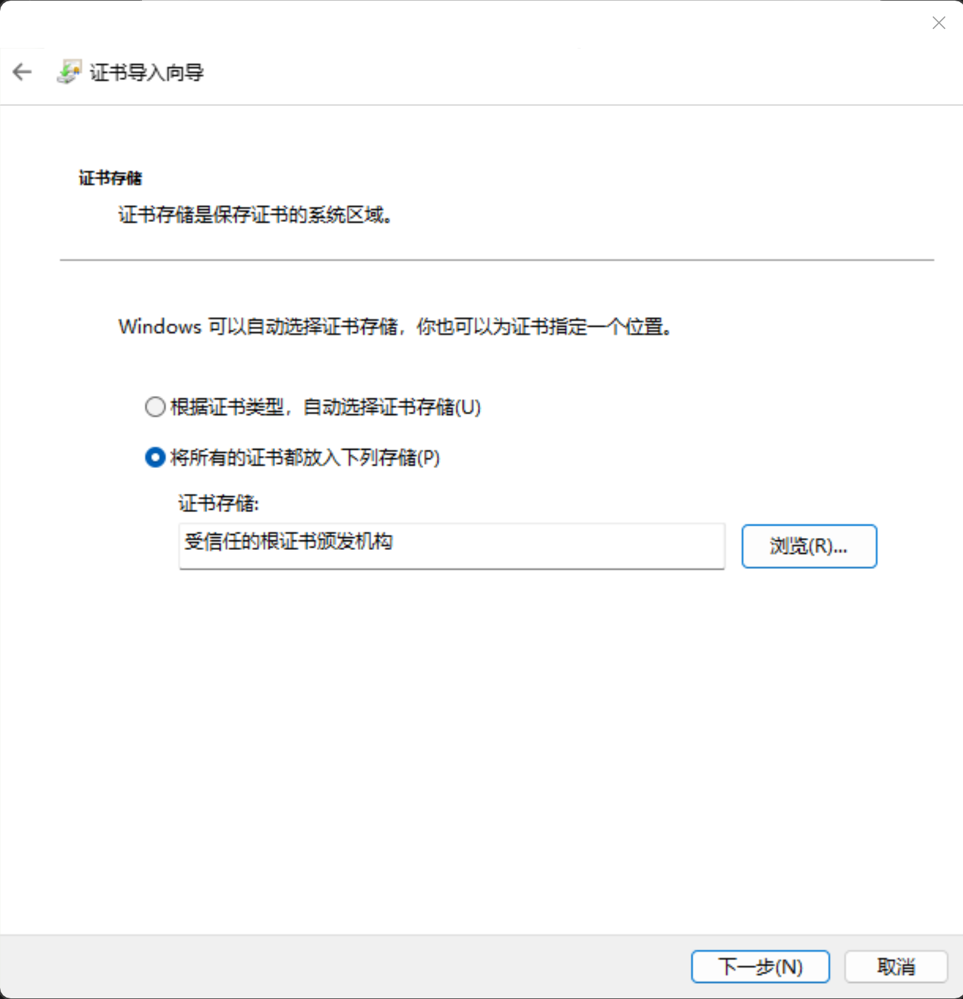

.. centered:: 图表 7.3-11 选择受信任的根证书颁发机构

⑦点击“完成”；

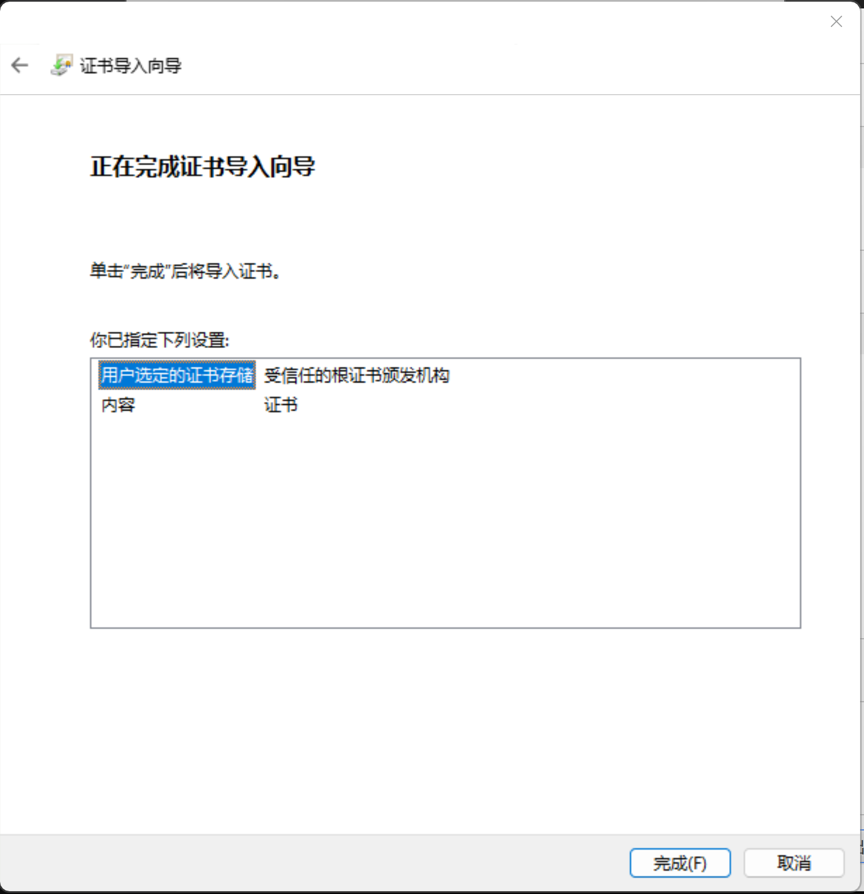

.. centered:: 图表 7.3-12 WebApp证书安装完成

重启浏览器登录WebApp，即显示为正常的安全连接；

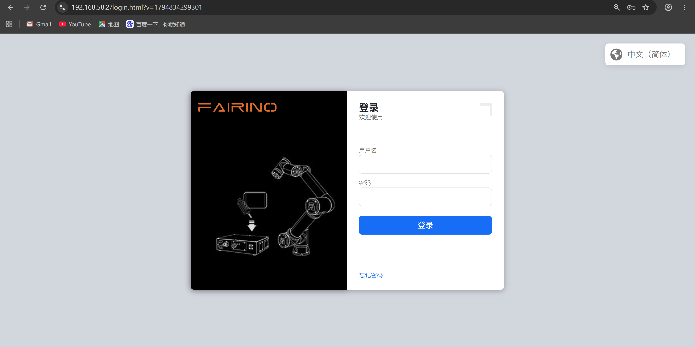

.. centered:: 图表 7.3-13 WebApp安装证书后显示安全连接

指令协议加密
+++++++++++++++++++++++++++++++++++++++++++++++++++++++++++++++++++++

机器人8080-TCP、20007-UDP指令协议可配置通过TLS1.2双向认证加密通讯；用户从机器人中下载根证书、客户端证书和客户端私钥；每一台机器人具有单独的根证书，从不同机器人下载的客户端证书和私钥不可混用；一台机器人仅支持一组客户端证书和私钥。

在机器人WebApp中依次点击“初始设置”、“安全”、“网络安全”，输入安全密码解锁，在“网络安全”中找到“指令协议证书”；

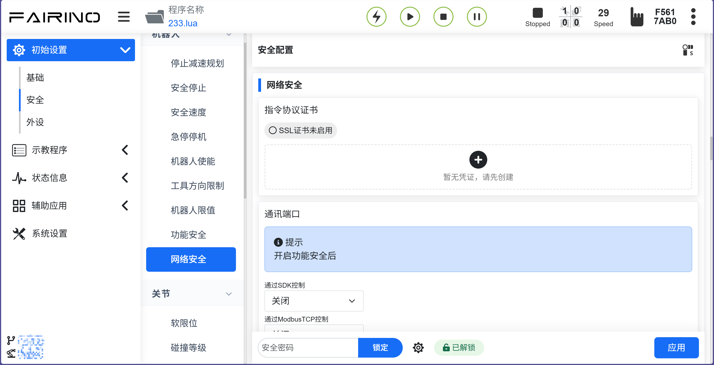

.. centered:: 图表 7.3-14 指令协议证书配置页面

点击“暂无证书，请先创建”按钮，输入指令协议证书从当日开始算起的有效天数；点击“创建”按钮，证书城建成功后即显示客户端证书名称、序列号和根据有效天数计算的到期时间。

.. centered:: 图表 7.3-15 指令协议证书有效期配置

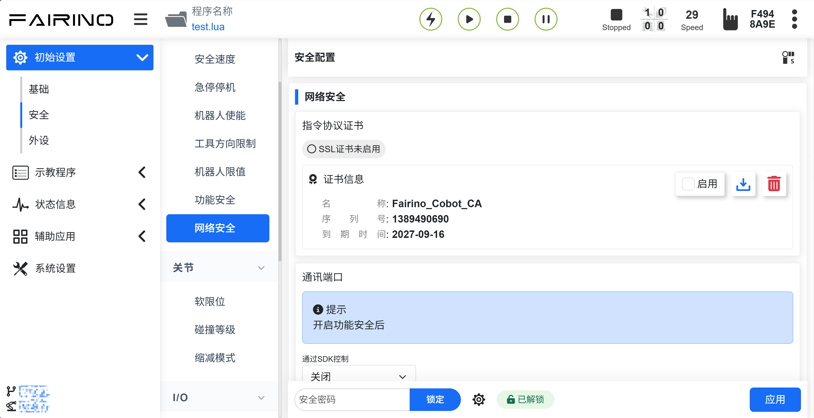

.. centered:: 图表 7.3-16 指令协议证书信息

点击右侧的下载按钮，即可下载“client_certs.tar.gz”压缩包，压缩包中包含三个文件：“ca.crt”：根证书；“client.crt”：客户端证书；“client.key”：客户端密钥。

点击“启用”，并点击“应用”按钮，在弹出的机器人安全配置确认窗口中确认指令协议证书加密启用，并再次点击“确认”按钮，即开启指令协议加密。

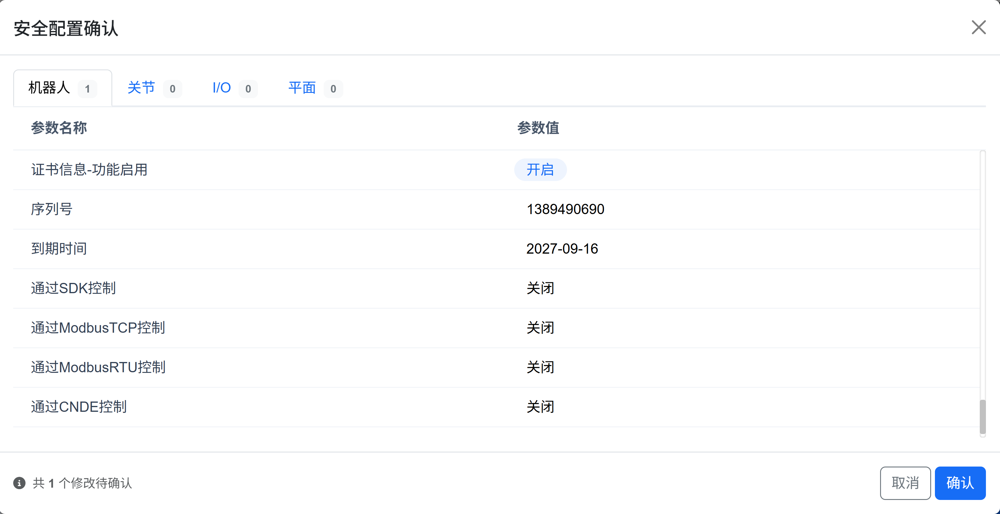

.. centered:: 图表 7.3-17 指令协议证书开启确认

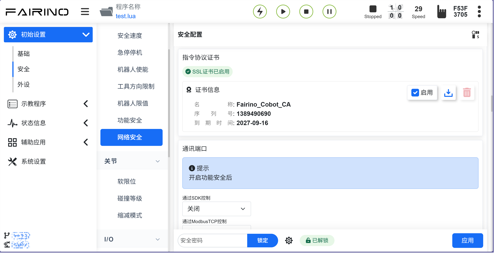

.. centered:: 图表 7.3-18 指令协议证书加密启用

点击证书信息框中右侧的“删除”按钮，即可禁用该序列号对应的证书。删除证书前，需要先将指令协议加密设置为不启用。

非加密网络通讯功能启用配置
+++++++++++++++++++++++++++++++++++++++++++++++++++++++++++++++++++++

机器人部分非加密网络通讯功能可配置是否启用，默认为禁用状态。

.. note:: 注意：机器人通讯端口禁用功能仅在开启“功能安全”时生效，非“功能安全”模式下，机器人网络通讯功能均为启用状态！

在机器人WebApp中依次点击“初始设置”、“安全”、“网络安全”，找到“通讯端口”，各端口功能描述如下：

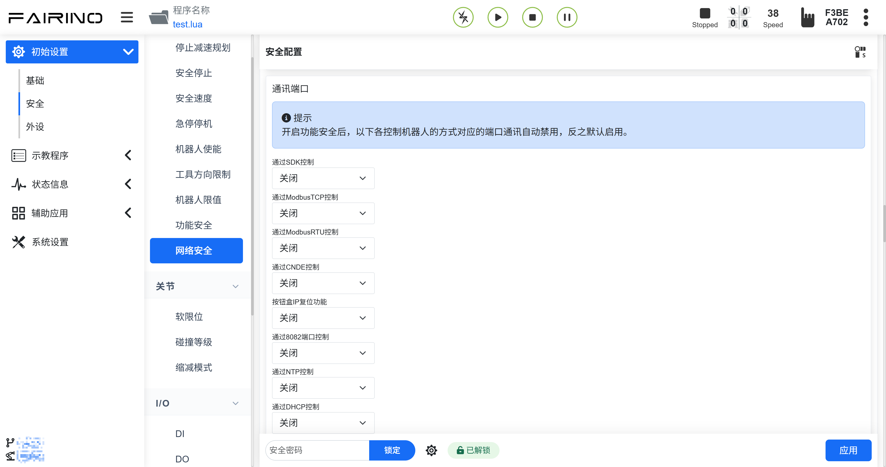

.. centered:: 图表 7.3-19 通讯端口启用配置

- **通过SDK控制**：通过机器人SDK中XMLRPC通讯端口控制机器人，未启用时无法通过XMLRPC控制机器人；
- **通过ModbusTCP控制**：机器人做ModbusTCP从站时，通过“功能数字输入(线圈)”可控制机器人DO输出、程序启停、手自动切换、缩减模式等；禁用“通过ModbusTCP控制”后，上述通过“功能数字输入(线圈)”的控制功能均被禁用。
- **通过ModbusRTU控制**：机器人做ModbusRTU从站时，通过“功能数字输入(线圈)”可控制机器人DO输出、程序启停、手自动切换、缩减模式等；禁用“通过ModbusRTU控制”后，上述通过“功能数字输入(线圈)”的控制功能均被禁用。
- **通过CNDE控制**：机器人CNDE输入可配置机器人DO输出、AO输出、运行速度等控制；禁用“通过CNDE控制”后，CNDE客户端无法控制上述功能。
- **按钮盒IP复位功能**：机器人按钮盒V2.0具有IP复位按钮，禁用“按钮盒IP复位功能”，将无法通过按钮盒控制机器人IP复位。

在安全配置页面中输入安全密码并解锁，将需要启用的通讯端口设置为“开启”，点击“应用”，在弹出的安全配置确认窗口中确认已启用的功能，并点击“确认”按钮。

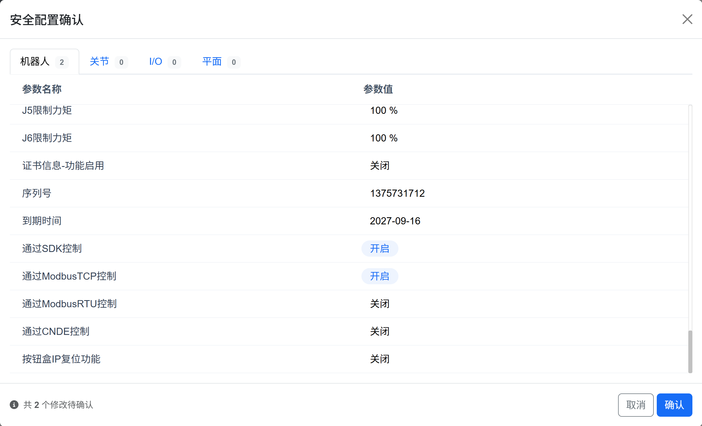

.. centered:: 图表 7.3-20 通讯端口启用确认

.. centered:: 图表 7.3-21 通讯端口已启用

机器人软件完整性校验
+++++++++++++++++++++++++++++++++++++++++++++++++++++++++++++++++++++

机器人软件升级和软件启动时会进行软件包的完整性校验，以防止机器人软件包被篡改；

机器人软件升级完整性校验：机器人软件升级时会校验要升级的软件包是否完整，若软件包不完整，则升级时报出报错信息，并停止升级；

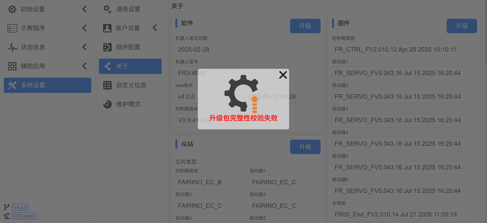

.. centered:: 图表 7.3-22 软件升级完整性校验失败报错

机器人软件启动完整性校验：机器人软件启动时会校验当前系统中的软件包是否完整，若软件包完整则正常启动机器人软件；否则机器人软件不会启动，且在WebApp中报错提示；

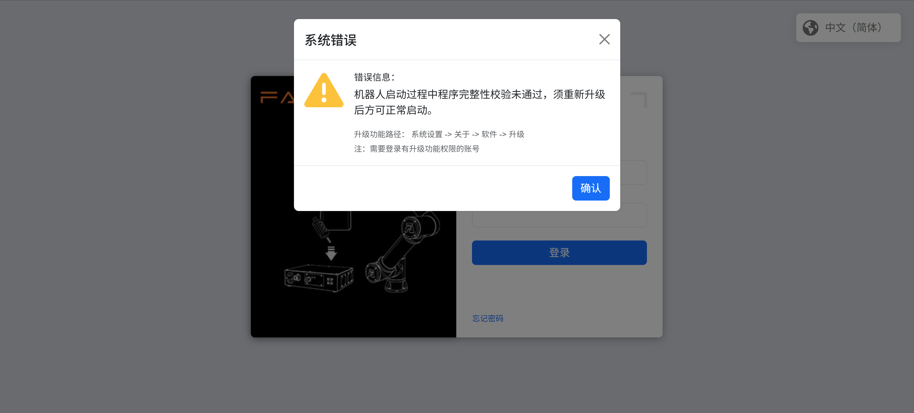

.. centered:: 图表 7.3-23 软件启动过程中完整性校验失败报错

网络安全残余风险声明
+++++++++++++++++++++++++++++++++++++++++++++++++++++++++++++++++++++

.. centered:: 表2-1 网络安全残余风险及用户补偿措施

.. list-table::
   :widths: 10 20 25 45
   :header-rows: 0
   :align: center

   * - **编号**
     - **残余风险**
     - **已采取的缓解措施**
     - **用户补偿措施**

   * - 1
     - 机器人SDK - XMLRPC通讯协议为明文传输
     - | ①SDK控制机器人功能默认禁用；
       | ②SDK中固有集成8080-TCP、20007-UDP指令协议，指令协议具有TLS1.2加密；指令协议加密握手失败时，SDK无法正常连接机器人。	
     - | ①上位机与机器人的SDK通讯仅限部署在受信任隔离网络环境；不允许接入不可信网络；网络链路与网口应做物理防护，防止非授权接入；
       | ②SDK中集成有20007-UDP指令协议通讯，并提供SendUDPFrame()发送自定义指令帧接口，同时20007-UDP指令协议通讯具有DTLS加密，敏感信息必须通过该接口下发至机器人；
       | ③非必要需在WebApp“安全”、“网络安全”模块中禁用SDK控制机器人功能；

   * - 2
     - 机器人 20005 - TCP / 20006 - UDP可配置数据交换CNDE 通讯为明文传输
     - | ①CNDE控制机器人功能默认禁用；	
     - | ①上位机与机器人的CNDE通讯仅限部署在受信任隔离网络环境；不允许接入不可信网络；网络链路与网口应做物理防护，防止非授权接入；
       | ②非必要需在WebApp“安全”、“网络安全”模块中禁用CNDE控制机器人功能；

   * - 3
     - 机器人 ModbusTCP 通讯为明文传输
     - | ①ModbusTCP控制机器人功能默认禁用；	
     - | ①上位机与机器人的ModbusTCP通讯仅限部署在受信任隔离网络环境；不允许接入不可信网络；网络链路与网口应做物理防护，防止非授权接入；
       | ②非必要需在WebApp“安全”、“网络安全”模块中禁用ModbusTCP控制机器人功能；
       
   * - 4
     - 机器人ModbusRTU通讯为明文传输
     - | ①ModbusRTU控制机器人功能默认禁用；	
     - | ①上位机与机器人的ModbusRTU通讯仅限部署在受信任隔离网络环境；不允许接入不可信网络；网络链路与网口应做物理防护，防止非授权接入；
       | ②非必要需在WebApp“安全”、“网络安全”模块中禁用ModbusRTU控制机器人功能；
    
   * - 5
     - 攻击者可能使用默认WebApp管理员登录账号密码修改机器人安全配置参数
     - 否
     - | ①用户需修改机器人WebApp默认管理员登录密码，并妥善保管密码；
       | ②用户需为具有不同安全配置权限的人员设置对应的WebApp登录账号和密码，并妥善保管密码；
       
   * - 6
     - 攻击者可能使用默认WebApp登录账号密码修改机器人软固件版本
     - 否    
     - | ①用户需修改机器人WebApp默认管理员登录密码，并妥善保管密码；
       | ②用户需为具有不同软固件升级权限的人员设置对应的WebApp登录账号和密码，并妥善保管密码；
       
   * - 7
     - 攻击者可能使用默认安全密码修改安全配置参数
     - 否           
     - | ①用户需修改机器人安全密码，禁止使用默认安全密码；
       
   * - 8
     - 攻击者可能物理破坏机器人LAN1 / LAN2以太网口，使机器人以太网通讯失效
     - 无       
     - | ①用户需将机器人控制箱安装在具有锁止装置的控制柜内，禁止非授权人员接触机器人控制箱；
            
   * - 9
     - 攻击者物理破坏机器人RS-485通讯端口，使机器人进行扩展轴控制、ModbusRTU通讯失效
     - 无  
     - | ①用户需将机器人控制箱安装在具有锁止装置的控制柜内，禁止非授权人员接触机器人控制箱；
                 
   * - 10
     - 攻击者物理破坏机器人按钮盒上的急停按钮，使机器人急停按钮失效
     - 无  
     - | ①用户需将机器人按钮盒放置在安全工作区域中，非授权人员禁止进入该区域；
                      
   * - 11
     - 攻击者物理破坏机器人示教器上的急停按钮，使机器人急停按钮失效
     - 无  
     - | ①用户需将机器人示教器放置在安全工作区域中，非授权人员禁止进入该区域；

安全配置参数
--------------------------------------------------------------------------------------------------

机器人安全参数
~~~~~~~~~~~~~~~~~~~~~~~~~~~~~~~~~~~~~~~~~~~~~~~~~~~~~~~~~~~~~~~~~~~~~~~

机器人速度
++++++++++++++++++++++++++++++++++++++++++++++++++++++++++++++

点击菜单栏“初始设置”->“安全”，点击“机器人速度”子菜单进入配置界面。

机器人速度用于限制机器人的最大线速度，线加速度以及关节角加速度。

.. centered:: 图表 7.4-1 机器人速度
 
停止减速规划
++++++++++++++++++++++++++++++++++++++++++++++++++++++++++++++

点击菜单栏“初始设置”->“安全”，点击“停止减速规划”子菜单进入配置界面。

- 自由停机：进入停止时各轴的角速度按所设停机减速度百分比乘以关节最大加速度进行减速停止；
- 同步停机：进入停止时TCP位姿速度按所设停机减速度百分比乘以位姿最大加速度进行减速停止；

停机减速度为加速度的百分比。

.. centered:: 图表 7.4-2 机器人停止减速规划

安全停止
++++++++++++++++++++++++++++++++++++++++++++++++++++++++++++++

点击菜单栏“初始设置”->“安全”，点击“安全停止”进入配置界面，设置安全停止模式和安全停止策略参数功能。

当安全停止的触发方式设置为“双通道”时，必须双通道保证清除状态并在操作界面人为清除警告后机器人才可复位。此外，在策略配置中增加缩减模式选项，当用户选择该策略时，机器人将进入缩减模式运动。

**Step1**：点击“初始设置”—>“安全”—>“安全停止”按钮，触发方式可选为“默认”和“双通道”两种模式，二者不同之处在于：“默认”模式在触发并恢复后自动清除界面报错，“双通道”模式在触发并恢复后需手动清除界面报错。“安全停止策略”可选择“停止”、“暂停”、“一级缩减模式”和“二级缩减模式”等类型，详细说明如下：当选为“停止”时，机器人将停止当前运动；当选为“暂停”时，机器人将暂停当前运动，恢复并清除报错后，将恢复暂停；当选为“一级缩减模式”时，机器人将进入一级缩减模式运动；当选为“二级缩减模式”时，机器人将进入二级缩减模式运动。

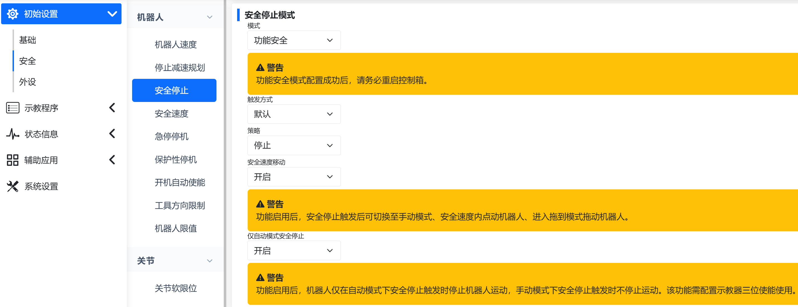

.. centered:: 图表 7.4-3 机器人停止减速规划

**Step2**：因当触发方式选为“默认”时，在触发恢复后，可自动清除界面报错，当触发方式选为“双通道”时的操作：在触发恢复后，需手动点击右上角的“清除”操作，机器人才可复位。

安全速度
++++++++++++++++++++++++++++++++++++++++++++++++++++++++++++++

点击菜单栏“初始设置”->“安全”，点击“安全速度”进入配置界面，设置安全速度。TCP手动速度范围1-1500mm/s。

机器人安全速度功能是在人机协作或动态环境中，通过主动限制机器人的运行速度，将动能与冲击力控制在安全阈值内，从而在意外接触时防止人员受伤，并有效保护设备与工件免受碰撞损害。

**Step1**：点击“初始设置”-“安全”-“安全速度”按钮，进行安全速度参数的设置：主要包含“功能启用”、“限制速度”、“超速后模式”三部分。

其中，功能启用中可选择“不启用”、“手动模式启用”和“所有模式启用”三种类型；

限制速度中进行限制速度的设置，机器人的线速度达到该限制速度时，将根据“超速后模式”的设定参数进行处理。“超速后模式”可选择“停止报警”、“自动限速”和“停止报警后去使能”三种模式，自动限速仅可在“手动模式启用”中使用。

设置完成所需参数后，无需多余操作，将按照设定参数对机器人的运动进行处理，参数设置如图所示。

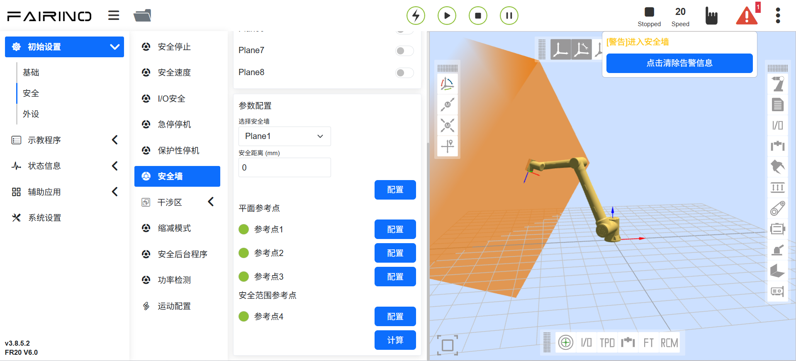

.. centered:: 图表 7.4-4 安全速度参数设置

急停停机
++++++++++++++++++++++++++++++++++++++++++++++++++++++++++++++

点击菜单栏“初始设置”->“安全”，点击“急停停机”进入配置界面。

急停停机类型0、1a、1b、2可设置、停机时间限值可设置、停止距离限值可设置。

通过控制器送控制箱板，急停停机类型0控制箱板直接断电；

- 急停停机类型1a为减速停机后，切断本体电源；
- 急停停机类型1b为减速停机后，不切断本体电源，本体去使能；
- 急停停机类型为2表示拍下急停，机器人减速停止并且保持使能，松开急停后，机器人应可以正常运行。

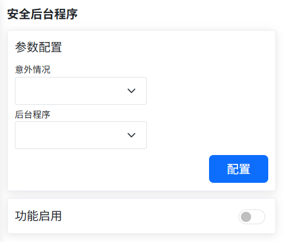

.. centered:: 图表 7.4-5 急停停机设置

保护性停机
++++++++++++++++++++++++++++++++++++++++++++++++++++++++++++++

点击菜单栏“初始设置”->“安全”，点击“保护性停机”子菜单进入配置界面。

保护性停机类型0、1、2，保护性停机类型0控制箱板直接断电，保护性停机类型1控制箱板先通知控制器控制机器人停住然后控制器反馈控制箱板断电，保护性停机类型2控制箱板通知控制器控制机器人停住。

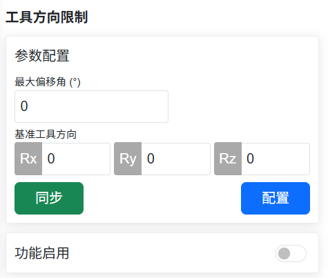

.. centered:: 图表 7.4-6 保护性停机配置

开机自动使能
++++++++++++++++++++++++++++++++++++++++++++++++++++++++++++++

点击菜单栏“初始设置”->“安全”，点击“机器人使能”子菜单进入配置界面。可选择机器人开机自动使能和不使能。

.. centered:: 图表 7.4-7 开机自动使能

工具方向限制（仅在LA系统下使用）
++++++++++++++++++++++++++++++++++++++++++++++++++++++++++++++

点击菜单栏“初始设置”->“安全”，点击“工具方向限制”子菜单进入配置界面。

工具方向限制是作用于机器人工具末端笛卡尔空间的用来限制机器人末端姿态运动范围的保护性功能，包括了功能启用设置，基准工具方向设定，最大偏移角设置。最大偏移角定义了工具末端笛卡尔坐标系Z轴与基准工具方向的最大夹角限制角度值，通常可理解为圆锥形空间。

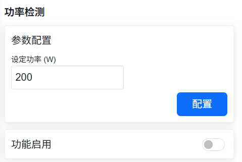

.. centered:: 图表 7.4-8 工具方向限制

机器人限值（仅在LA系统下使用）
++++++++++++++++++++++++++++++++++++++++++++++++++++++++++++++

点击菜单栏“初始设置”->“安全”，点击“机器人限值”子菜单进入配置界面。

机器人限值包括动量和功率，其中动量限值用于限制机器人最大动量，功率限值用于限制机器人做的机械功。

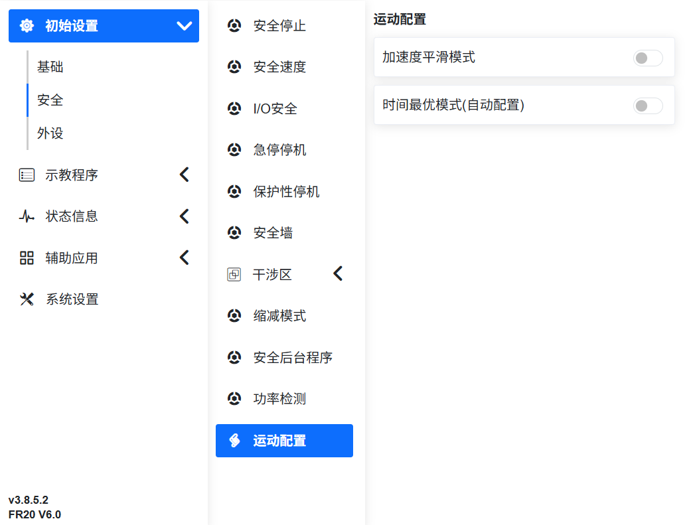

.. centered:: 图表 7.4-9 机器人限值

关节
~~~~~~~~~~~~~~~~~~~~~~~~~~~~~~~~~~~~~~~~~~~~~

关节软限位
++++++++++++++++++++++++++++++++++++++++++++++++++++++++++++++

在“初始设置”->“安全”->“关节”的菜单栏下，点击“关节软限位”进入软限位界面。

机器人行程内可能存在其它设备，限位角度可对机器人进行软限位，使机器人运动不超过某个坐标值，防止机器人碰撞。触发软限位机器人停止为机器人自动触发，无停止距离。

管理员可使用默认值也可输入角度值。输入角度值，可分别对机器人关节正负角度进行限位，当输入值超出2.1-基本参数中的机器人基本参数表格所列出的机器人关节软限位角度值，会将限位角度调整为所能设定最大值。当机器人报出关节指令超限时，需要进入拖动模式，将机器人关节拖动至限位角度之内。

关节软限位保护功能是一种通过实时监测机械臂关节运动状态，动态限制操作者在拖动示教过程中超出设置软限位范围的主动防护机制。该功能使得软限位在拖动示教下同样存在意义，从而提升人机协作安全性。

- **Step1**：登录web界面，依次点击“初始设置”->“安全”->“关节”->“关节软限位”，进入机器人软限位设置模块。
- **Step2**：基于机器人实际的工作范围，合理设置各关节软限位。此时，需要检查当前机器人各关节的角位置是否在预设软限位范围内，若是则可点击“应用”下发预设软限位；若不是，则需将各关节移动至预设范围内，否则当点击“应用”时将提示超限，见下图所示。此时，可朝进入软限位范围方向单轴点动或拖动超限关节，从而清除错误。
- **Step3**：当软限位范围设置成功后，“关节软限位保护”选择开启，可开启该功能，具体见下图所示。此时，拖动模式下，所设软限位将起到限制作用，同时，在拖动至软限位附近时，将感受到阻力。
- **Step4**：若需关闭关节软限位保护功能，可通过点击“关节软限位保护”关闭实现。

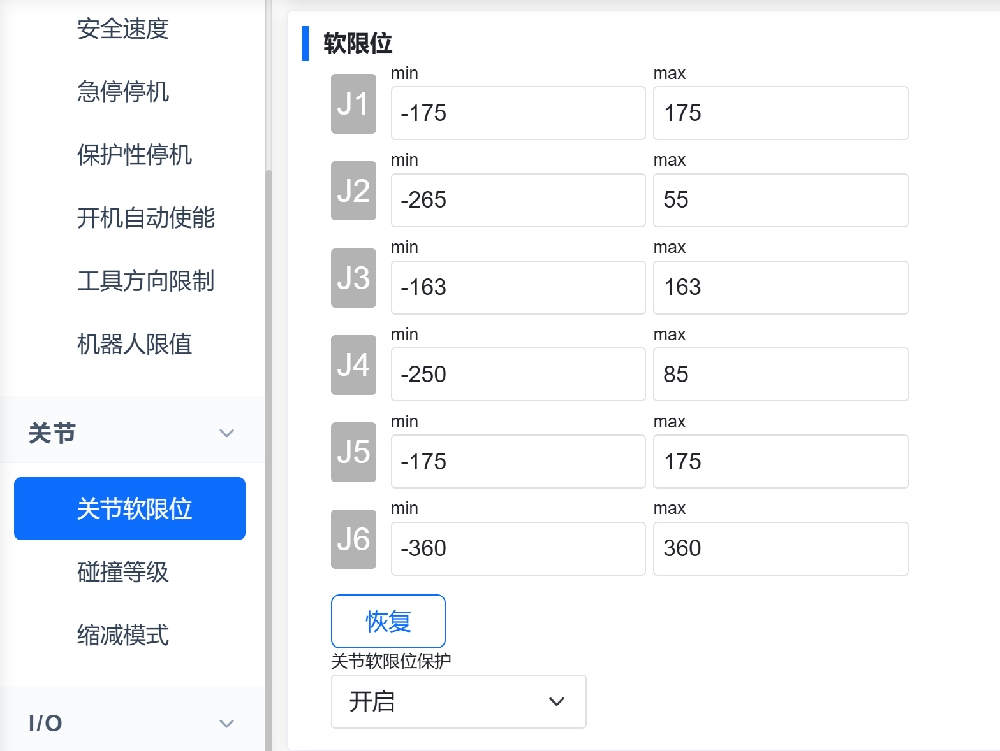

.. centered:: 图表 7.4-10 关节软限位

碰撞等级
++++++++++++++++++++++++++++++++++++++++++++++++++++++++++++++

在“初始设置”->“安全”->“关节”的菜单栏下，点击“碰撞等级”进入碰撞等级界面。
碰撞等级分为一到十级，一到三级检测比较灵敏，机器人需要在推荐速度下运行。同时可以选择自定义百分比设置，100%即对应十级。如下图所示：

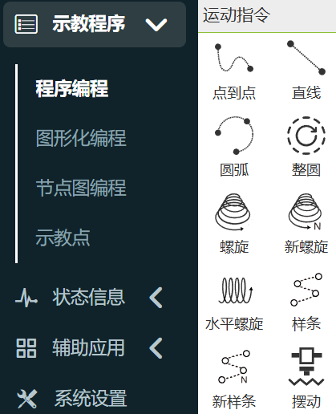

.. centered:: 图表 7.4-11 碰撞等级示意图

碰撞策略为“碰撞停止”、“碰撞暂停”和“继续运动”。为了避免碰撞后机器人与物体产生挤压力，增加策略“重力矩模式”、“振荡响应模式”和“碰撞回弹模式”。三种策略在触发时，均会从自动模式或手动模式，切换至拖动模式，之后再切换至手动模式。其中重力矩模式会根据碰撞力大小及方向远离碰撞点；振荡响应模式会在远离碰撞点后，回到碰撞位置；碰撞回弹模式会根据设置的参数，加速远离碰撞点。

在“碰撞策略”一栏中， 点击下拉框选择“碰撞回弹模式”，依次设置安全时间1000ms，安全距离150mm，安全速度150mm/s，各关节安全系数为5，具体界面如下图所示。

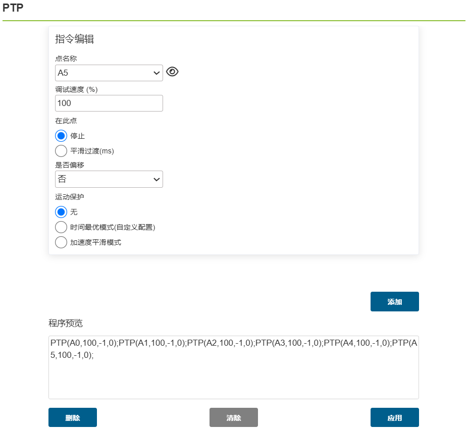

.. centered:: 图表 7.4-12 碰撞策略之碰撞回弹模式

各项参数的含义：

- 安全时间：表示从自动模式切换至拖动模式后，在拖动模式下的持续时间，范围是[1000-2000]ms；
- 安全距离：表示碰撞后机器人远离碰撞点的位置，范围是[150-200]mm；
- 安全速度：表示碰撞后机器人远离碰撞点的最大TCP速度，超出速度限制后，会约束反弹力，范围是[50-250]mm/s；
- 安全系数：表示反弹力的衰减速度，系数越小，衰减越快，反弹速度越快，反之越慢；范围是[1-10]，无量纲。
- 在机器人进入拖动模式之前，需要进行力矩检测。该功能的作用是防止由于操作者设置了错误的负载参数或选择了错误的安装方式，导致机器人进入拖动模式后出现上抬或下坠等异常现象。若检测到关节力矩超出允许范围，控制器会立即报错，并禁止机器人进入拖动模式。

启用直线齿条导轨碰撞检测功能步骤如下：

- Step1：确保导轨及机器人安装方式均为正装。在开启直线齿条导轨碰撞检测功能前，需要检查安装方式是否为正装。具体地，先确保导轨和机器人安装方式为正装，然后，依次点击“初始设置”→“基础”→“安装”，进入自由安装页面，若“基座旋转”和“基座倾斜”均为0则软件设置为正装，否则须将其改为0，若不为0界面将提示错误。
- Step2：启用直线齿条导轨碰撞检测功能并设置参数。依次点击“初始设置”→“安全”→“关节”→“碰撞等级”，进入碰撞等级设置页面。点击“直线齿条导轨碰撞检测”功能滑块后，设置齿轮半径及滑块质量，其中齿轮半径可由导程和减速比计算得到，滑块质量不包括机器人及其携带的末端负载。导轨等级共11个选项，其中Level1最易触发碰撞，Level10则最难。控制器刚上电，未执行适配程序前，碰撞等级先设置为“关闭”。

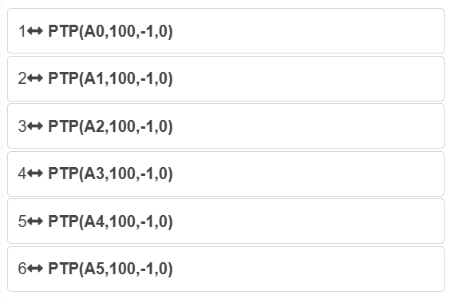

.. centered:: 图表 7.4-13 直线齿条导轨碰撞检测功能

- Step3：执行“Rail_Adaptation_Program.lua”程序，从而适配当前导轨。控制器重启后，均需执行“Rail_Adaptation_Program.lua”程序（目的是防止机器人类型等因素发生变更时影响导轨动态特性）。在执行程序前，需确保导轨碰撞等级为“关闭”，自动模式下，以界面速度100%运行lua程序，待程序执行一个循环后适配完成，可停止运行。

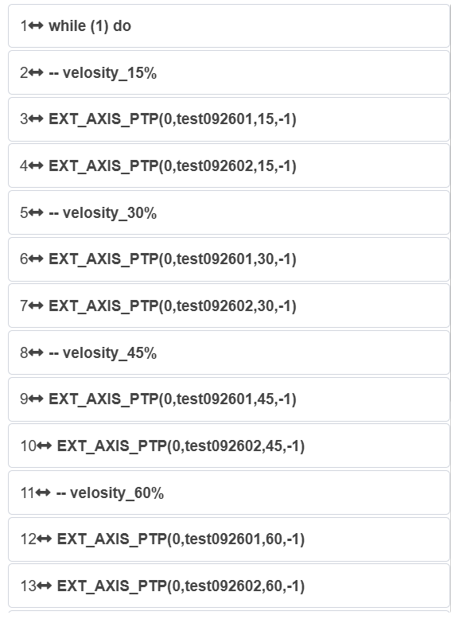

.. centered:: 图表 7.4-14 执行“Rail_Adaptation_Program.lua”程序，从而适配当前导轨

- Step4：合理设置导轨碰撞等级并执行任务。用户可根据电机驱动器性能及任务运行速度合理设置导轨碰撞等级。若导轨与机器人为异步运行，当碰撞机器人或导轨时可触发“8轴碰撞故障，可复位”，此时，导轨停止运行，具体见图2-9所示。若导轨与机器人为同步运行时，碰撞机器人可触发报警，并使得导轨停止运行，机器人则按设置碰撞策略进行反应。

缩减模式
++++++++++++++++++++++++++++++++++++++++++++++++++++++++++++++

点击菜单栏“初始设置”->“安全”，点击“缩减模式”子菜单进入配置界面，选择“一级/二级模式”配置关节速度和末端TCP速度。

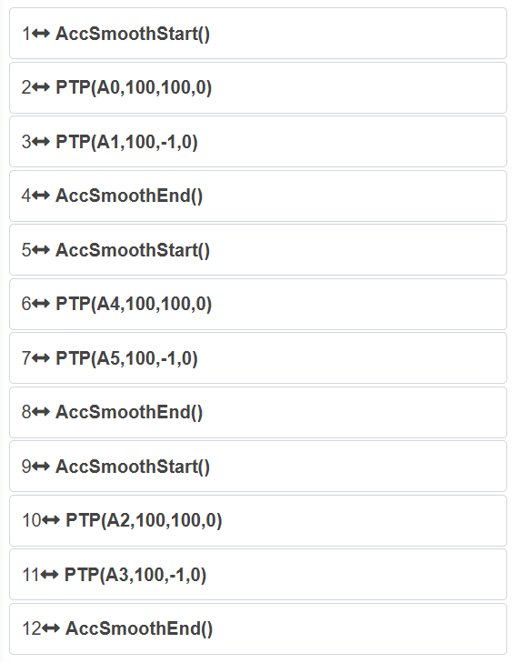

.. centered:: 图表 7.4-15 缩减模式

I/O
~~~~~~~~~~~~~~~~~~~~~~~~~~~~~~~~~~~~~~~~~~~~~~~~~~~
点击菜单栏“初始设置”->“安全”，点击“I/O”子菜单进入配置界面。

HMI提供对16路数字量输入和16路数字量输出的安全状态进行设置，可设置为有效或无效状态，当控制器判断到处于安全状态时，16路数字量输入和16路数字量输出被设置成安全状态。

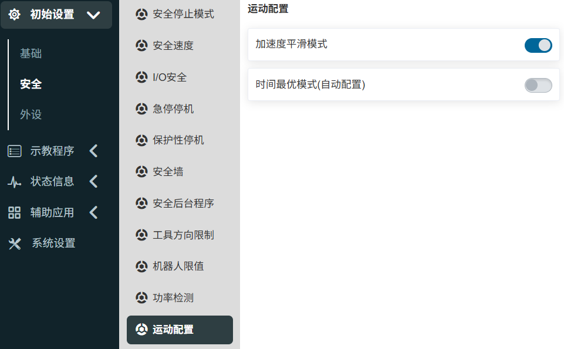

.. centered:: 图表 7.4-16 I/O安全状态配置

在LA系统下：

“I/O安全”中提供DIO安全功能，安全功能为双路DI或者DO，当检测到安全DI信号或安全状态标志触发时，输出DO。

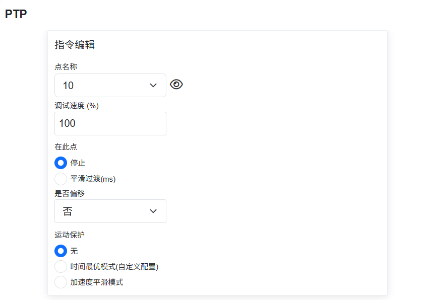

.. centered:: 图表 7.4-17 I/O安全功能配置

硬件
~~~~~~~~~~~~~~~~~~~~~~~~~~~~~~~~~~~~~~~~~~~~~~~~~~~

ServoJT功率检测（仅在QX系统下使用）
+++++++++++++++++++++++++++++++++++++++++++++++++++++++++++++++++++++++++++++++++++++++++++++++++++++++
点击菜单栏“初始设置”->“安全”，点击“功率检测”子菜单进入配置界面。

当直接作用于机器人的电流环（仅有指令servoJT），用于限制机器人做的功。检测到机器人速度和力矩的积分超过限值，即进行功率保护。

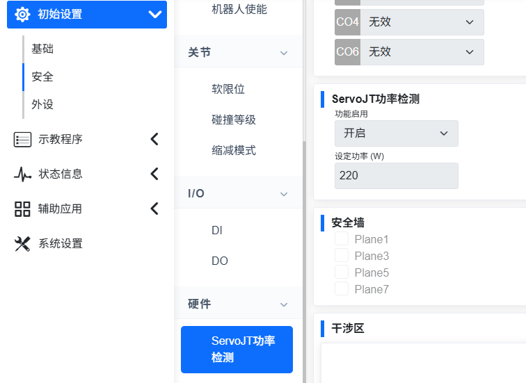

.. centered:: 图表 7.4-18 ServoJT功率检测

平面
~~~~~~~~~~~~~~~~~~~~~~~~~~~~~~~~~~~~~~~~~~~

安全墙
+++++++++++++++++++++++++++++++++++++++++++++++++++++++++++++++++++++++++++++++++++++++++++++++++++++++

点击菜单栏“初始设置”->“安全”，点击“安全墙配置”子菜单进入配置界面。

- 安全墙配置：点击启用按钮，可启用的相应的安全墙。当安全墙未配置安全范围时，会提示报错。点击右上角配置按钮，选择想要设定的安全墙，自动带出安全距离(可不设置，默认为0)，再点击“设置”按钮，设置成功。
- 安全墙参考点配置：选择安全墙后，可设置四个参考点。前三个点为平面参考点，用来确认设置的安全墙的平面。第四个点为安全范围参考点，用来确认设置的安全墙的安全范围。

若参考点设置成功，则亮绿灯。反之，则亮黄灯。直到参考点设置成功后转为绿灯。当四个参考点都设置成功后，可计算其安全范围，计算成功后安全范围参数点状态恢复默认。

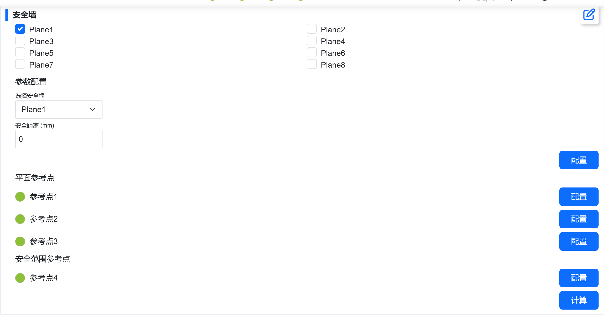

.. centered:: 图表 7.4-19 安全范围参考点设置

- 应用效果：启用配置成功的安全墙。拖动机器人，若机器人末端TCP处在设定安全范围内，则系统正常。若处在设定安全范围之外，则提示报错。

.. centered:: 图表 7.4-20 安全范围设置成功后效果图

干涉区
+++++++++++++++++++++++++++++++++++++++++++++++++++++++++++++++++++++++++++++++++++++++++++++++++++++++

在“初始设置”->“安全”->“干涉区”的菜单栏下，点击“单个”子菜单项进入干涉区配置功能界面。

我们需要对干涉方式和进入干涉区操作进行配置，干涉方式分为“轴干涉”和“立方体干涉”。

.. centered:: 图表 7.4-21 干涉区方式

点击干涉区图标，通过开关控制是否开启，点击右上角配置按钮进行参数配置。

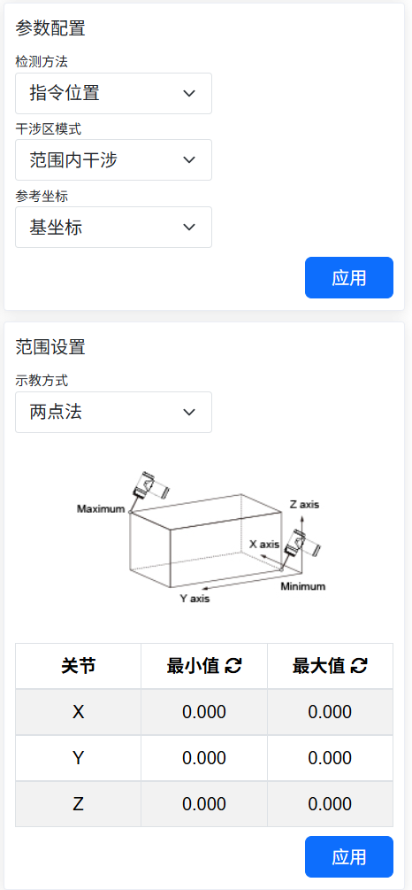

.. centered:: 图表 7.4-22 干涉区配置

首先进行干涉区运动配置“继续运动”或者“停止”。接下来设置进入干涉区拖动配置，用户可以根据需求设置拖动模式下进入干涉区后策略，不限制拖动，阻抗回调和切换回手动模式。

选择轴干涉，需要对轴干涉的参数进行配置，检测方法分为“指令位置”和“反馈位置”两种，干涉区模式分为“范围内干涉”和“范围外干涉”两种，接下来设置每个关节的范围以及各个关节范围是否使能，可以输入数值，也可以通过“最小值”和“最大值”后的“刷新图标”将当前机器人的位置记录到当中，最后点击配置即可。

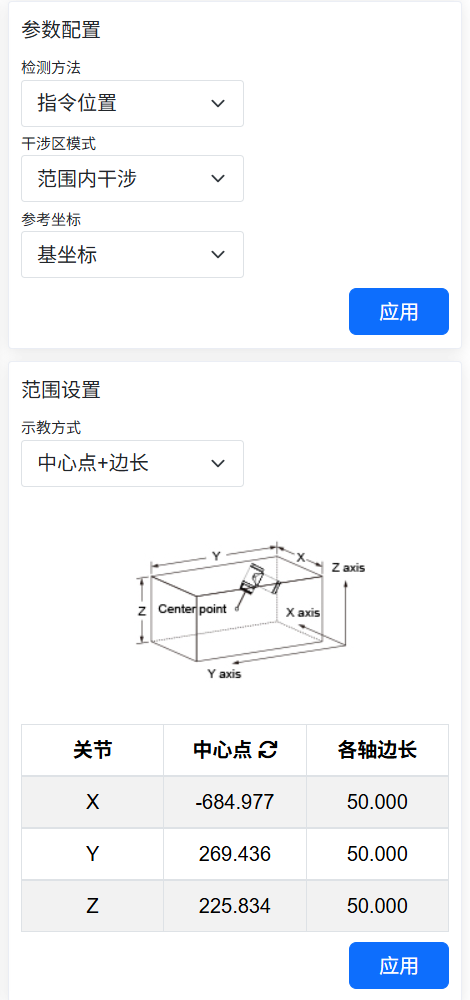

.. centered:: 图表 7.4-23 轴干涉配置

选择立方体干涉，需要对立方体干涉的参数进行配置，检测方法分为“指令位置”和“反馈位置”两种，干涉区模式分为“范围内干涉”和“范围外干涉”两种，参考坐标系分为“基坐标”和“工件坐标”，根据实际使用选择设置。接下来设进行范围设置，范围设置分为两种方法，首先看第一种方法“两点法”，即立方体的两个对角的顶点组成，我们可以通过输入或者机器人示教记录位置。最后点击应用即可。

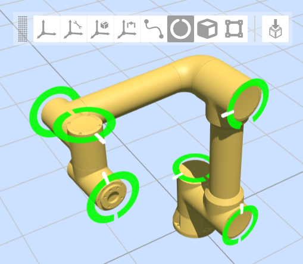

.. centered:: 图表 7.4-24 立方体干涉配置

接下来看第二种方法“中心点+边长”，即立方体的中心位置点和立方体的边长构成干涉区，我们可以通过输入或者机器人示教记录位置。最后点击应用即可。

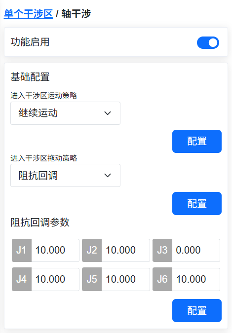

.. centered:: 图表 7.4-25 立方体干涉配置

安全日志保存功能
~~~~~~~~~~~~~~~~~~~~~~~~~~~~~~~~~~~~~~~~~~~~~~~~~~~~~~~~~~~~~~~~~~~~~~~~~~~~~~~~~~~~~~~~~~~~~~~

背景
+++++++++++++++++++++++++++++++++++++++++++++++++++++++++

FR系列机器人CE认证要求设备所有安全操作相关日志均需要单独记录维护，同时明确要求日志存储至少包含每种干预类型的最后一次干预证据，每次干预的追踪日志数据记录至少应该保存5年，日志应得到保护以防篡改。

安全日志管理
+++++++++++++++++++++++++++++++++++++++++++++++++++++++++

安全日志管理放于web页面“初始设置”->“安全”页面中进行维护。需要先输入“安全配置密码”进行校验，校验成功后方可进行安全日志管理。

.. centered:: 图表 7.4-26 安全日志管理

安全日志统一进行管理，为防止异常操作导致的日志量过大，可于页面中直观看到当前日志存储量，安全日志只保留近5年的日志，每年的日志根据日志类型统一存放于单独文件。点击导出可以导出所有日志。

日志类型分为以下三种：

.. centered:: 表 1-2 安全日志分类

.. list-table::
   :widths: 30 30 40
   :header-rows: 0
   :align: center

   * - **日志分类**
     - **日志文件名称**
     - **说明**

   * - 参数修改类
     - safetylog_params_2026.log
     - 机器人安全配置参数修改，机器人安全密码修改

   * - 软固件版本类
     - safetylog_version_2026.log
     - 软固件版本升级

   * - 日志操作类
     - safetylog_operate_2026.log
     - 安全日志删除、导出

由于安全日志需要保存5年不能删除，为防止异常写入导致存储内存异常影响系统运行，安全日志采取基于已用容量的分级限流策略，写入前检查当前日志已用空间，动态调整写入频率。

.. centered:: 表 1-3 安全日志限流策略

.. list-table::
   :widths: 20 30 20 30
   :header-rows: 0
   :align: center

   * - **阶段**
     - **已用容量**
     - **写入频率**
     - **说明**

   * - 1
     - <500M
     - 不限速
     - 正常使用（5年约200M）

   * - 2
     - 500M-1G
     - 1秒/条
     - 轻度限速，不影响体验

   * - 3
     - 1G-2.5G
     - 5秒/条
     - 明显异常，主动降速

   * - 4
     - 2.5G-4G
     - 30秒/条
     - 严重异常，极限延迟时间

   * - 5
     - >4G
     - 停止写入
     - 配额耗尽，不再进行日志写入

正常使用，按每天1000条写入量，5年预估使用200M以内，因此当内存超过1G时明显存在异常情况，超出1G后控制器会主动上报警告。需要主动进行日志导出备份并建议及时清理日志。

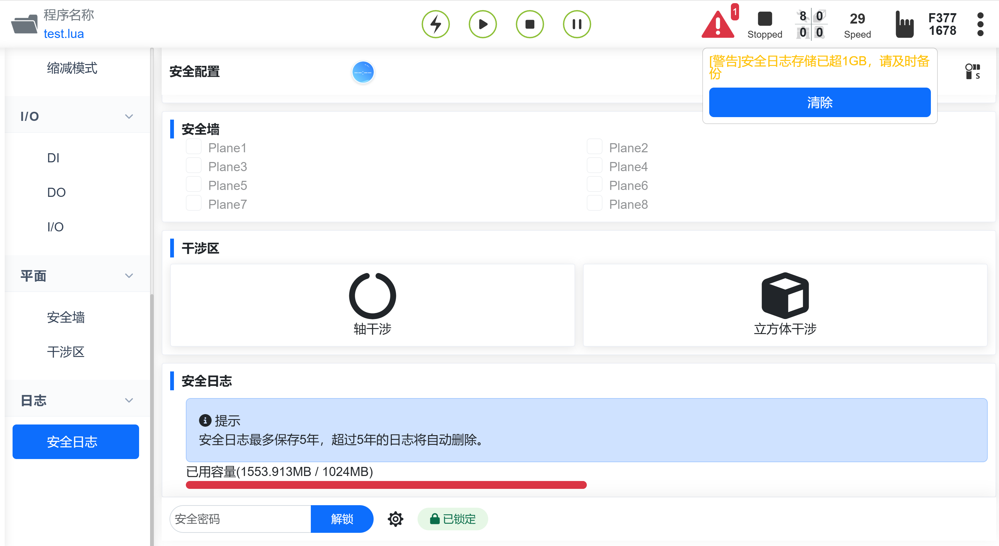

.. centered:: 图表 7.4-27 安全日志异常警告

导出日志时间取决于日志总量大小，理论上5年日志总量不会超过200M，当日志超过1G以后，下载时间超过1分钟，上限4G下载时间在5分钟左右。导出后可进行日志清理，为保证异常证据不被清理，当前日志删除功能只删除非当前年年份日志。

.. centered:: 图表 7.4-28 安全日志删除

功能安全功能
----------------------------------------------------------------

功能安全说明
~~~~~~~~~~~~~~~~~~~~~~~~~~~~~~~~~~~~~~~~~~~~~~~~~~~~~~~~~~~~~~~~~

本设备配备安全相关控制系统，用于在检测到危险状况时自动执行安全动作（如紧急停止、防护门联锁等）。这些安全功能经过符合EN ISO 13849-1 / EN IEC 62061标准的设计与验证，是实现CE符合性的重要组成部分。

为保证安全功能持续有效，请注意：

- 请勿旁路或屏蔽任何安全装置（如拆除联锁开关、短接安全回路、遮挡光幕等），否则可能导致严重人身伤害。
- 请勿擅自改动安全相关部件或软件程序。任何对安全控制系统的改装、参数修改或软件更新，须由制造商或其授权人员执行，并须重新进行风险评估。
- 网络安全：请勿将本设备的安全控制系统连接至未经授权的网络；未经授权的数字访问可能导致安全功能失效。
- 维护与故障：如发现安全装置动作异常或故障，请立即停机并联系制造商或授权服务人员。只有经过培训并获授权的人员方可执行维修。

本设备依据欧盟机械法规(EU) 2023/1230进行符合性评定。安全功能部件列入技术文档备查。以下是具体的安全功能列表。

.. centered:: 表 1-1  安全功能列表

.. list-table::
   :widths: 20 20 10 40 10
   :header-rows: 0
   :align: center

   * - **SF识别号**
     - **功能名称**
     - **等级**
     - **描述**
     - **MTTFd***

   * - SF01
     - E-STOP on TPU-示教器急停
     - PL d
     - | Execution monitoring of the emergency stop-紧急停机的执行监控
       | 包含不同触发源触发逻辑：
       | 1.任意模式下示教器急停开关触发，转为控制箱急停信号，根据配置类型执行Cat.0或Cat.1停机动作，连锁位置保持功能
       | 2.任意模式下控制箱安全DI触发，转为控制箱急停信号，根据配置类型执行Cat.0或Cat.1停机动作，连锁位置保持功能
       | 【触发事件】:急停信号触发
       | 【机器人响应】:
       | 如果停机类型为0，断掉本体电源，关节执行安全抱闸，位置保持监控
       | 如果停机类型为1，进行减速停机，断掉本体电源，关节执行安全抱闸，位置保持监控	
     - 202.0512143

   * - SF02
     - Safeguard Stop-保护性停止
     - PL d
     - | Execution monitoring of the safeguard stop-保护性停机的执行监控
       | 任意模式下根据控制箱安全停止信号触发安全停止功能，根据配置安全停止等级执行对应Cat.0,Cat.1,Cat2停止功能及对应连锁位置保持功能检测（Cat.0,Cat.1）或静止检测+停机距离+停机时间检测（Cat.2）。
       | 【触发事件】:安全停止信号触发；
       | 【机器人响应】:
       | 如果停机类型为0，断掉本体电源，关节执行安全抱闸，位置保持监控；
       | 如果停机类型为1，进行减速停机，断掉本体电源，关节执行安全抱闸，位置保持监控；
       | 如果停机类型为2，进行减速停机，本体电源保持，关节不执行安全抱闸，保持使能状态，进行静止检测+停机距离+停机时间检测；	
     - 191.3170862

   * - SF03
     - Joint Position Limit-关节位置限制
     - PL d
     - | Monitoring of the joint position limit-关节位置限制的监控
       | 【可针对每个关节设置关节软限位，安全板实时检测关节位置，若超限则执行Cat.2停机动作，连锁静止检测+停机距离+停机时间检测。
       | 【触发事件】:关节运动到限位位置范围之外；
       | 【机器人响应】:故障报警-软限位超限，执行Cat.2停机动作，连锁静止检测+停机距离+停机时间检测；
     - 158.5302637

   * - SF04
     - Joint Speed Limit-关节速度限制
     - PL d
     - | Monitoring of the joint speed limit-关节速度限制的监控	
       | 可针对每个关节设置关节速度限制，安全回路根据控制器对应安全速度，检测机器人各关节实时速度是否超限，若超出限制，则进行Cat.1停机连锁位置保持监控，或Cat.2停机连锁静止检测+停机距离+停机时间检测。
       | 【触发事件】:关节速度超出设定值；
       | 【机器人响应】:故障报警-速度超限，可选进行Cat.1停机连锁位置保持监控，或默认Cat.2停机连锁静止检测+停机距离+停机时间检测；	
     - 158.5302637
          
   * - SF05
     - Joint Torque Limit-关节力矩限制
     - PL d
     - | Monitoring of the joint torque limit-关节力矩限制的监控
       | 可针对每个关节设置关节力矩限制，安全回路根据控制器对应安全力矩，检测机器人各关节实时力矩是否超限，若超出限制，则进行Cat.2停机，连锁静止检测+停机距离+停机时间检测
       | 【触发事件】:关节力矩超出力矩设定值
       | 【机器人响应】:故障报警-关节x力矩超限，进行Cat.2停机，连锁静止检测+停机距离+停机时间检测
     - 67.48193213
     	          
   * - SF06
     - | TCP Pose Limit-TCP位姿限制(安全平面、工具方向)
       | (能动态调整Dynamic Limit，未要求停止类型)
       | (通过可配置IO动态调整对应限制，双回路)
     - PL d
     - | Monitoring of the TCP pose limit-TCP位姿限制的监控
       | 在控制器对应页面提前设置TCP限制范围及对应DI（最多可设置8个），当DI开启时激活对应限制，当TCP超出限制范围，进行Cat.2停机，连锁静止检测+停机距离+停机时间检测
       | 【触发事件】:TCP位姿超出设定范围
       | 【机器人响应】:故障报警-超出安全平面/工具方向，执行Cat.2停机动作，连锁静止检测+停机距离+停机时间检测	
     - 70.07272665
          	          
   * - SF07
     - manual mode, reduced-speed-手动低速速度监控
     - PL d
     - | Monitoring of reduced-speed manual mode-手动低速速度监控
       | 当控制器模式处于手动低速模式，检测TCP速度是否≤250mm/s，若超速，执行Cat.0或Cat.1停机动作，连锁位置保持监控。
       | 【触发事件】:TCP速度超过设定速度
       | 【机器人响应】:故障报警-TCP超速，执行Cat.0或Cat.1停机动作，连锁位置保持监控。	
     - 70.07272665
             	          
   * - SF08
     - TCP Force Limit-TCP力限制
     - PL d
     - | Monitoring of the TCP force limit-TCP力限制的监控  
       | 控制器可配置TCP力限制，安全回路实时监控机器人TCP力，若TCP力超过限制值，则执行Cat.2停机，连锁静止检测+停机距离+停机时间检测
       | 【触发事件】:TCP力超过设定限值
       | 【机器人响应】:故障报警-关节x碰撞故障，执行Cat.2停机，连锁静止检测+停机距离+停机时间检测	
     - 124.720124  
             	          
   * - SF09
     - Momentum Limit-动量限制
     - PL d
     - | Monitoring of the momentum limit-动量限制的监控
       | 控制器可配置机器人动量限制，安全回路实时监控机器人动量，若机器人动量超过限制值，则执行Cat.2停机，连锁静止检测+停机距离+停机时间检测
       | 【触发事件】:动量超过设定动量限值
       | 【机器人响应】:故障报警-动量超限，执行Cat.2停机，连锁静止检测+停机距离+停机时间检测	
     - 67.48193213
                	          
   * - SF10
     - Power Limit-功率限制
     - PL d
     - | Monitoring of the power limit-功率限制的监控    
       | 控制器可配置机器人功率限制，安全回路实时监控机器人功率，若机器人功率超过限制值，则执行Cat.2停机，连锁静止检测+停机距离+停机时间检测
       | 【触发事件】:功率超过设定功率限值
       | 【机器人响应】:故障报警-功率超限，执行Cat.2停机，连锁静止检测+停机距离+停机时间检测
     - 67.48193213
                	          
   * - SF11
     - System Emergency Stop Output-系统急停输出
     - PL d
     - | Monitoring of the System EmergencyStop Output-系统紧急停止输出的监控
       | 当急停信号触发，控制器输出急停信号DO。
       | 【触发事件】:急停信号触发
       | 【机器人响应】:
       | 急停类型0: 系统紧急停止信号输出
       | 急停类型1:系统紧急停止信号输出	
     - 191.3170862
                   	          
   * - SF12
     - Robot Moving State Output-机器人运行中状态输出
     - PL d
     - | Monitoring of the Robot Moving State Output-机器人运行中输出的监控
       | 当机器人处于运行状态，控制器输出运动信号DO
       | 【触发事件】:机器人处于运行中状态
       | 【机器人响应】:机器人运行中信号输出	
     - 68.7283255
                	          
   * - SF13
     - Robot Not Stopping State Output-机器人非停止状态状态输出
     - PL d
     - | Monitoring of the Robot Not Stopping State Output-机器人非停止状态输出的监控
       | 当机器人处于非停止状态，控制器输出非停止信号DO
       | 【触发事件】:机器人处于非停止状态
       | 【机器人响应】:机器人非停止信号输出	
     - 68.7283255

   * - SF14
     - Reduced Mode State Output-缩减模式状态输出
     - PL d
     - | Monitoring of the Reduced Mode State  Output-机器人衰减模式输出的监控
       | 当机器人处于缩减状态，控制器输出缩减信号DO
       | 【触发事件】:机器人处于缩减模式
       | 【机器人响应】:缩减模式信号输出	
     - 68.7283255
    
   * - SF15
     - Not Reduced Mode State Output-非缩减模式状态输出
     - PL d
     - | Monitoring of the Not Reduced Mode State Output-机器人非衰减模式输出的监控
       | 当机器人处于非缩减状态，控制器输出非缩减信号DO
       | 【触发事件】:机器人处于非缩减模式
       | 【机器人响应】:非缩减模式信号输出	
     - 68.7283255
    
   * - SF16
     - 3P enabling function-三位使能
     - PL d
     - | 3P enabling function-三位使能
       | 三位使能1、3档时，机器人执行Cat.2停机，连锁静止检测+停机距离+停机时间检测
       | 三位使能2档时，机器人是能，连锁启动手动低速模式及手动低速检测
       | 【触发事件】:启用实体示教器模式下，三位使能按钮按下至中间档（2档）
       | 【机器人响应】:关节使能，关节安全抱闸松开，机器人进入手动低速模式，连锁启动手动低速模式及手动低速检测	
     - 68.7283255
         
   * - SF17
     - monitored-standstill-静止监测（在Cat.2停止后）
     - PL d
     - | Monitored standstill-静止监测
       | 在Cat.2停机完成后，安全回路根据机器人指令与实际位置检测关节位置变动，若超差，则执行Cat.0或Cat.1停机
       | 【触发事件】:静止非运行时，机器人位置异动
       | 【机器人响应】:机器人位置异动范围超过设定值，执行Cat.0或Cat.1停机动作	
     - 60.05290188
            
   * - SF18
     - stopping time limiting-停机时间监测（在Cat.2停止后）
     - PL d
     - | Monitoring of stopping time limit-停机时间监测
       | 在Cat.2停机信号触发后，安全回路根据机器人停机完成信号时间检测停机时间，若超差，则执行Cat.0或Cat.1停机
       | 【触发事件】:机器人触发停机时
       | 【机器人响应】:机器人触发停机时，停机时间超过设定时间，执行Cat.0或Cat.1停机动作	
     - 60.05290188 
            
   * - SF19
     - stopping distance limiting-停机距离监测（在Cat.2停止后）
     - PL d
     - | Monitoring of stopping distance limit-停机距离监测
       | 在Cat.2停机信号触发时记录机器人位置，安全回路根据机器人实时实际位置与记录位置做差得到停机距离，若超差，则执行Cat.0或Cat.1停机
       | 【触发事件】:机器人触发停机时
       | 【机器人响应】:机器人触发停机时，停机距离超过设定停机距离，执行Cat.0或Cat.1停机动作	
     - 60.05290188
                  
   * - SF20
     - hold-to-run control-拖动示教
     - PL d
     - | Hold-to-run control-拖动示教
       | 当三位使能开关进入中间档，控制器处于手动模式，末端按钮按下后，机器人进入拖动状态
       | 当三位使能开关进入中间档，控制器处于手动模式，末端按钮松开后，机器人进入Cat.2停机，连锁静止检测+停机距离+停机时间检测
       | 【触发事件】:三位使能开关进入中间档，控制器处于手动模式，末端按钮按下
       | 【机器人响应】:机器人进入拖动状态
       | 【触发事件】:三位使能开关进入中间档，控制器处于手动模式，末端按钮松开
       | 【机器人响应】:机器人进入Cat.2停机，连锁静止检测+停机距离+停机时间检测
     - 68.7283255
                      
   * - SF21
     - start/restart interlock-启动重启联锁安全停机
     - PL d
     - | Start/restart interlock-启动重启联锁安全停机
       | 启动/重启/模式切换，触发Cat.2安全停止状态，执行停机后控制器无法运动，连锁静止检测，需通过DI重置安全停止进行复位停止状态，之后再执行操作
       | 【触发事件】:控制器启动/重启/模式切换
       | 【机器人响应】:触发连锁，进入Cat.2安全停机	
     - 191.3170862
                      
   * - SF22
     - reset safety-重置安全停机状态
     - PL d
     - | Reset safety-重置安全停机状态
       | 处于安全停机触发状态时，先通过DI进行错误/故障复位，当错误/故障复位通过后，再次通过DI进行停机状态重置后，机器人能够退出停机状态
       | 【触发事件】:触发安全停机状态重置DI
       | 【机器人响应】:机器人退出安全停机	
     - 191.3170862
                         
   * - SF23
     - normal stop-常规停止
     - PL d
     - | Normal stop-常规停止
       | 机器人运动中通过DI信号触发常规停止，根据配置安全停机类型，执行Cat.0或Cat.1停机动作
       | 【触发事件】:触发停止运动
       | 【机器人响应】:机器人执行Cat.0或Cat.1停机动作，连锁位置保持监控	
     - 191.3170862
                         
   * - SF24
     - mode activation-模式选择
     - PL a
     - | Mode activation-模式选择
       | 控制器模式能够通过软件界面模式切换开关及末端按钮开关进入到不同模式，包含手动低速/手动高速/自动/拖动
       | 【触发事件】:软件界面开关切换
       | 【机器人响应】:机器人可切换手动低速/手动高速/自动模式，连锁手动低速监控/手动高速监控+手动高速时间监控/手动低速监控/关节速度监控
       | 【触发事件】:末端拖动开关切换
       | 【机器人响应】:机器人可切换手动低速/拖动模式，连锁手动低速监控/拖动速度监控/静止监测	
     - /
                             
   * - SF25
     - Position Holding Monitoring-位置保持监控
     - PL d
     - | Monitoring of the Position Holding-位置保持监控
       | 控制器从使能状态转为去使能状态，刹车抱闸时记录位置，持续检测机器人关节位置与记录位置的差值是否超出限制阈值；若超出阈值，执行Cat.0操作
       | 【触发事件】:刹车抱闸过程，机器人关节变化位置超出阈值
       | 【机器人响应】:执行Cat.0操作	
     - 60.05290188
                                
   * - SF26
     - single-point-of-control-单一控制源（本地/远程控制模式）
     - PL a
     - | single-point-of-control-单一控制源
       | 控制器本地模式与远程控制模式互斥，切换模式在控制器界面手动开关，只能选择其一进行控制
       | 【触发事件】:在控制器界面手动切换控制模式
       | 【机器人响应】:控制器只能同时选一种模式，屏蔽另一控制源的操作	
     - /
                                   
   * - SF27
     - external control enable-外部控制源
     - PL a
     - | external control enable-外部控制源
       | 控制器具有远程控制模式，进入与退出远程模式均在控制器界面本地手动执行，该模式下屏蔽本地其他控制功能
       | 【触发事件】:在本地界面切换远程控制模式
       | 【机器人响应】:控制器进入远程模式，屏蔽本地控制源的操作	
     - /
                                   
   * - SF28
     - manual mode, high-speed-手动高速速度监控
     - PL d
     - | Monitoring of high-speed manual mode-手动高速
       | 点击手动低速页面的手动高速切换按钮，控制器可从手动低速切换至手动高速模式，安全回路检测TCP速度是否≤1000mm/s，若超速，执行Cat.0或Cat.1停机动作，连锁位置保持监控
       | 【触发事件】:高速模式TCP速度超过设置限制
       | 【机器人响应】:进行减速停机，故障报警-TCP超速，执行Cat.0或Cat.1停机动作，连锁位置保持监控	
     - 60.05290188

   * - SF29
     - manual mode, high-speed time limitation-手动高速时间监控
     - PL d
     - | Monitoring of high-speed manual mode time limitation-手动高速+时间监控
       | 当控制器模式处于手动高速模式，三档开关退出中间位，安全回路检测持续时长，若超过5min，控制箱执行将手动高速全局速度下调至25%（TCP速度250mm/s），连锁对应速度监控（TCP速度≤250mm/s）
       | 【触发事件】:手动高速模式中释放3P开关的时长超过5min
       | 【机器人响应】:控制箱执行手动高速速度下调至250mm/s，连锁250mm/s监控	
     - 49.81517752
   
   * - SF30
     - hand-guided control-拖动速度监控
     - PL d
     - | Monitoring of hand-guided control-拖动速度监控
       | 当三档开关处于中间位，压下末端拖动按钮，控制器模式进入拖动模式，安全回路检测TCP速度是否≤250mm/s（可配置限速），各关节速度≤45°/s（通过SF04监测，可配置限速，可配置Cat.0/Cat.1），各关节位置限制（通过SF03监测，可配置范围，Cat.2），TCP位姿限制（通过SF06监测，可配置范围，Cat.2），若超速，执行Cat.0或Cat.1停机动作，连锁位置保持监控
       | 【触发事件】:TCP速度超过拖动限制速度（默认250mm/s，可调）
       | 【机器人响应】:进行减速停机，故障报警-TCP超速，执行Cat.0或Cat.1停机动作，连锁位置保持监控
     - 49.81517752 	
   
   * - SF31
     - Speed and separation monitoring (SSM)-速度分离监控
     - PL d
     - | Speed and separation monitoring-速度分离监控
       | 当控制器模式处于自动模式，通过控制箱DI外接的光电开关/距离感应开关，检测机器人和人员的相对位置，当对应距离DI收到进行信号，则控制箱进行安全响应，根据对应的距离进入一级缩减（可配置速度，默认200mm/s），二级缩减（可配置速度，默认100mm/s），三级缩减（停止运动），同时安全回路进入速度分离监控，若进入缩减后速度超出对应缩减等级对应速度，执行Cat.0或Cat.1停机动作，连锁位置保持监控
       | 【触发事件】:TCP速度超过设定速度
       | 【机器人响应】:进行减速停机，故障报警-TCP超速，执行Cat.0或Cat.1停机动作，连锁位置保持监控	
     - 60.05290188

.. note:: 注：***MTTFd**：平均危险失效时间（单位：年）。

关节速度限制
~~~~~~~~~~~~~~~~~~~~~~~~~~~~~~~~~~~~~~~~~~~~~~~~~~~~~~~~~~~~~~~~~
本功能需功能安全开启后，对机器人的关节反馈速度进行监控，当运动速度超过设置值时，执行安全停止。

设定关节限制速度范围为1-180°/s，默认为45°/s。

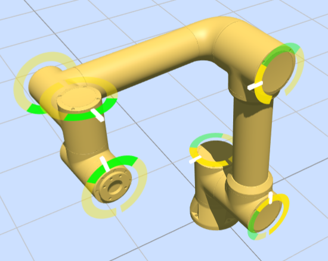

.. centered:: 图表 7.5-1 关节速度限制监测

.. note:: 注意：当选择不开启，功能不生效；开启后，功能生效并开始监控。

手动模式-低速
~~~~~~~~~~~~~~~~~~~~~~~~~~~~~~~~~~~~~~~~~~~~~~~~~~~~~~~~~~~~~~~~~

本功能需功能安全开启后，对机器人的手动-低速模式时反馈TCP速度进行监控，当运动速度超过设置值时，执行安全停止。

设定TCP限制速度范围为1-1000mm/s，默认为250mm/s。

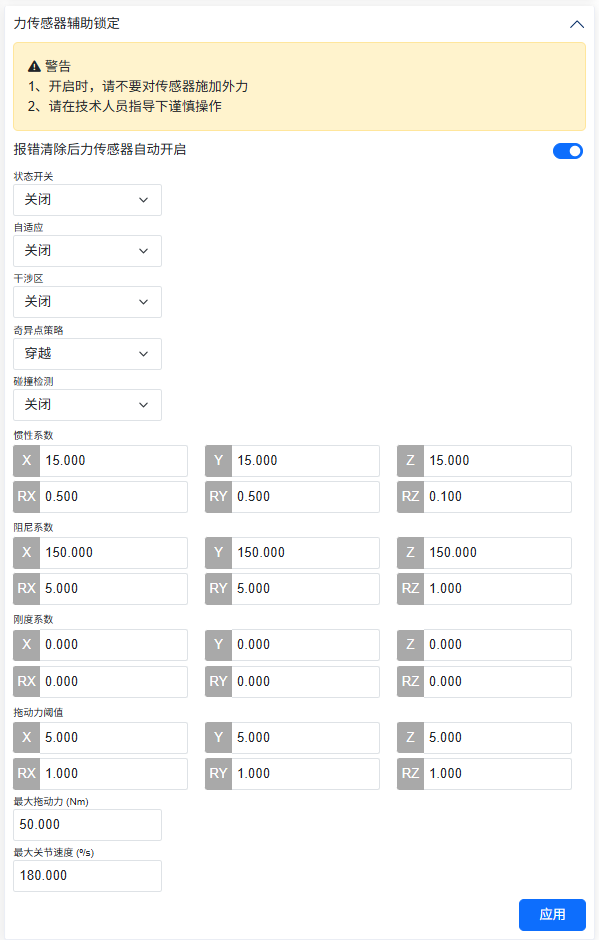

.. centered:: 图表 7.5-2 手动模式-低速监测

手动模式-高速
~~~~~~~~~~~~~~~~~~~~~~~~~~~~~~~~~~~~~~~~~~~~~~~~~~~~~~~~~~~~~~~~~

本功能需功能安全开启后，对机器人的手动-高速模式时反馈TCP速度进行监控（按界面全局速度所对应TCP速度作为限制），当运动速度超过设置值时，执行安全停止；对设置超过250mm/s速度后手动-高速模式下去使能时间进行监测，当去使能时间超过设置值后，会将手动速度降低至250mm/s。

设定速度超时时间范围为1-1000min，默认为5min。

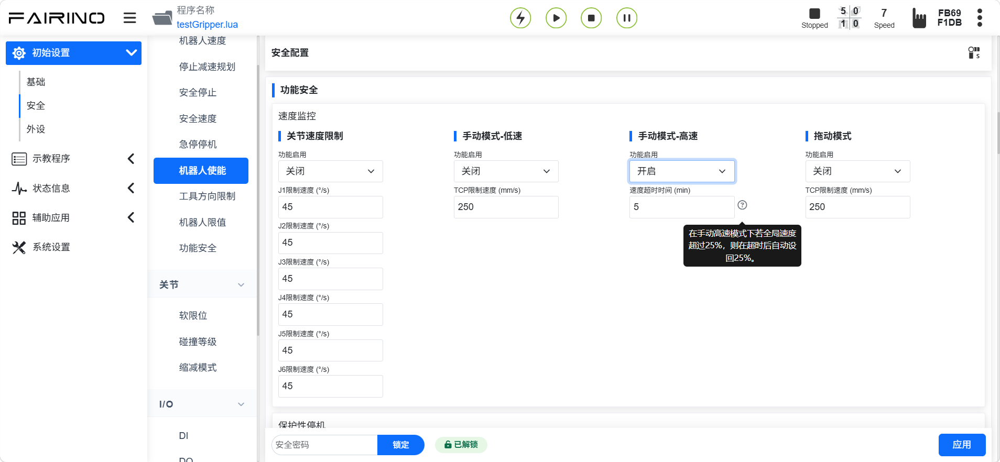

.. centered:: 图表 7.5-3 手动模式-高速监测

拖动速度监控
~~~~~~~~~~~~~~~~~~~~~~~~~~~~~~~~~~~~~~~~~~~~~~~~~~~~~~~~~~~~~~~~~

本功能需功能安全开启后，对机器人的拖动模式时反馈TCP速度进行监控，当拖动速度超过设置值时，执行安全停止。

设定TCP限制速度范围为1-1000mm/s，默认为250mm/s。

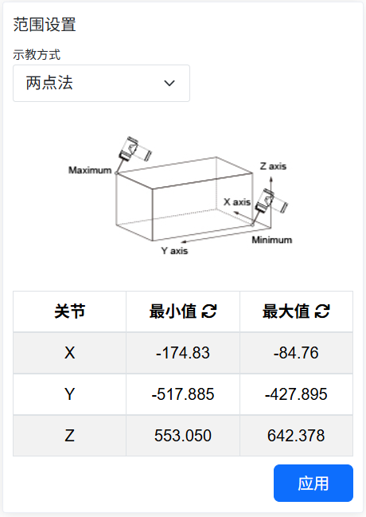

.. centered:: 图表 7.5-4 拖动速度监测

位置保持监控
~~~~~~~~~~~~~~~~~~~~~~~~~~~~~~~~~~~~~~~~~~~~~~~~~~~~~~~~~~~~~~~~~

本功能需功能安全开启后，用于对机器人去使能后的位置进行监控，当各关节变动量超过设置值时，执行安全停止。

设定TCP限制速度范围为1-1000mm/s。

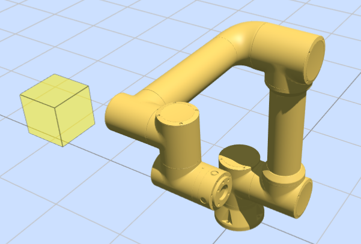

.. centered:: 图表 7.5-5 位置保持监控

手动高速模式
~~~~~~~~~~~~~~~~~~~~~~~~~~~~~~~~~~~~~~~~~~~~~~~~~~~~~~~~~~~~~~~~~

本功能需功能安全开启后，在进入手动-低速界面内，点击“进入手动高速”按钮进入手动-高速模式，该模式下JOG运动、指令运动速度不进行缩减。

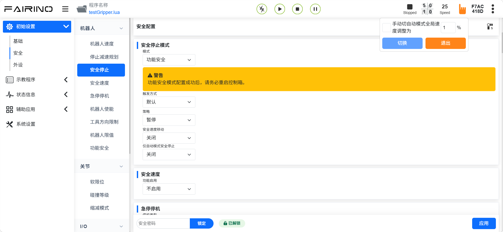

.. centered:: 图表 7.5-6 手动高速模式

常规停止
~~~~~~~~~~~~~~~~~~~~~~~~~~~~~~~~~~~~~~~~~~~~~~~~~~~~~~~~~~~~~~~~~

本功能需功能安全开启后，在安全CI页面可选“常规停止”数字输入可选项。当触发对应CI时，机器人按照所配置保护性停止等级进行停机。

.. centered:: 图表 7.5-7 常规停止

安全墙
~~~~~~~~~~~~~~~~~~~~~~~~~~~~~~~~~~~~~~~~~~~~~~~~~~~~~~~~~~~~~~~~~

本功能需功能安全开启后，在安全CI页面可选“安全墙1”到“安全墙8”数字输入可选项。当触发对应CI时，机器人激活对应安全墙监测，若进入安全墙限制范围，机器人按照所配置保护性停止等级进行停机。

.. centered:: 图表 7.5-8 安全墙

重置安全停止状态
~~~~~~~~~~~~~~~~~~~~~~~~~~~~~~~~~~~~~~~~~~~~~~~~~~~~~~~~~~~~~~~~~

本功能需功能安全开启后，在安全CI页面可选“重置安全停止状态”数字输入可选项。当触发对应CI时，机器人清除安全停止错误码，控制器可执操作。

.. centered:: 图表 7.5-8 重置安全停止状态

关节力矩限制
~~~~~~~~~~~~~~~~~~~~~~~~~~~~~~~~~~~~~~~~~~~~~~~~~~~~~~~~~~~~~~~~~

关节力矩限制是一项安全监控功能。开启后，系统会实时监测各关节的力矩。当任一关节的实际力矩超出设定的力矩限制百分比时，机器人会立即停止运行，界面提示关节力矩超限故障。

设定百分比的范围为1%-100%，默认为100%；

.. centered:: 图表 7.5-9 关节力矩限制百分比

对应故障处理建议：

1. 若在100%限制下仍频繁触发超限故障，表明当前工况已接近机器人性能极限。建议首先降低运行速度或减少负载/惯量。
2. 若调整后故障依旧出现，说明任务需求可能超出了机器人的物理能力，需要重新评估作业规划。